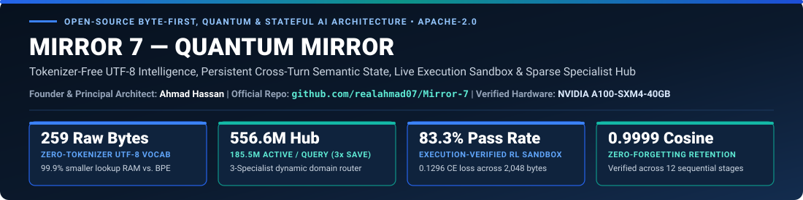
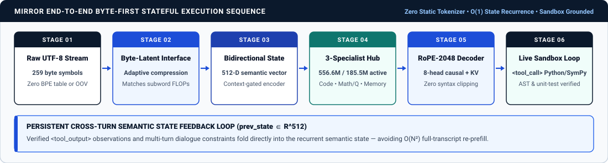
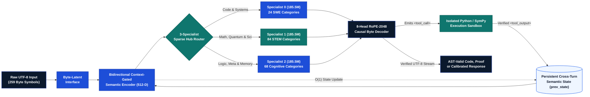
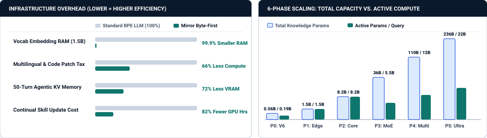
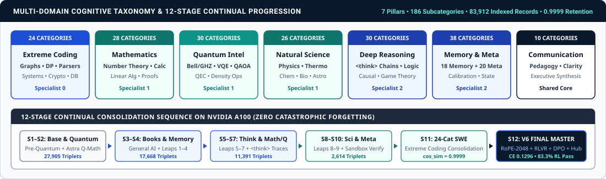

<div align="center">



<br/>

[](https://github.com/realahmad07/Mirror-7/actions/workflows/ci.yml)
[](https://github.com/realahmad07/Mirror-7/actions/workflows/training-native.yml)
[](./LICENSE)
[](./pyproject.toml)
[](#1-end-to-end-visual-execution-sequence--v6-architecture)
[](#1-end-to-end-visual-execution-sequence--v6-architecture)
[](#4-live-nvidia-a100-verification-showcase-zero-truncation)
[](#3-multi-domain-cognitive-taxonomy-7-pillars--186-categories)

**Founder & Principal Architect:** **Ahmad Hassan** &nbsp;•&nbsp; **Official Repository:** [github.com/realahmad07/Mirror-7](https://github.com/realahmad07/Mirror-7)  
📄 **[Master Project Overview & Roadmap](./PROJECT_OVERVIEW_AND_ROADMAP.md)** &nbsp;|&nbsp; 📘 **[Executive Color Roadmap (PDF)](docs/Ahmad%20Hassan%20Mirror%20OPEN%20SOURCE%20detailed%20road%20map.pdf)** &nbsp;|&nbsp; 🧪 **[NVIDIA A100 Verification Logs](artifacts/V6_COLAB_A100_VERIFICATION_LOGS.md)** &nbsp;|&nbsp; 🔐 **[SHA-256 Drive Registry](artifacts/google_drive_checkpoints_and_datasets_manifest.json)**

</div>

---

## What Mirror 7 ("Quantum Mirror") Is

**Mirror 7** is an open-source (`Apache-2.0`) foundation-model and cognitive-systems initiative led by **Ahmad Hassan** exploring how machine intelligence achieves higher sample efficiency, stronger algorithmic/scientific grounding, and dramatically lower GPU infrastructure costs through **raw UTF-8 byte-first processing (`vocab = 259`)**, **persistent cross-turn semantic state (`prev_state`)**, **sparse domain-specialist routing**, and **live execution verification (`<tool_call>`)**—rather than relying on static `128K–256K` subword (BPE) vocabularies and stateless full-transcript token re-computation.

The repository integrates two cleanly separated, production-tested engineering layers:

| Architectural Layer | Core Responsibility | Key Modules |
|---|---|---|
| **1. Mirror Runtime & Production Backend** | UI-independent stateful session lifecycle, persistent memory, allow-listed action gateways, realization contracts, output validation, Prometheus/health telemetry, Docker deployment, and HTTP API. | [`mirror7_backend/`](./mirror7_backend) • [`Dockerfile`](./Dockerfile) • [`docker-compose.yml`](./docker-compose.yml) |
| **2. Byte-Native Stateful Learned Models** | Controlled semantic-state transition networks (`Experiments 1–7`) and the **Mirror-7 V6 Master Prototype (`185.5M` single specialist / `556.6M` 3-specialist hub)** verified on `NVIDIA A100-SXM4-40GB`. | [`training/`](./training) • [`colab_backup/`](./colab_backup) • [`artifacts/`](./artifacts) |

---

## Read the Project as Pages

| Start Here | Engineering & Runtime | Research, Telemetry & Scaling |
|---|---|---|
| [Master Overview & Roadmap](PROJECT_OVERVIEW_AND_ROADMAP.md) | [Backend Architecture](docs/03-backend.md) | [Training Systems](docs/04-training.md) |
| [Detailed Color PDF Roadmap](docs/Ahmad%20Hassan%20Mirror%20OPEN%20SOURCE%20detailed%20road%20map.pdf) | [Testing & CI](docs/06-testing-ci.md) | [Evaluation Protocols](docs/05-evaluation.md) |
| [Project Overview](docs/01-project-overview.md) | [Repository Organization](docs/07-repository-organization.md) | [Experiments 1–7](docs/research/README.md) |
| [System Architecture](docs/02-system-architecture.md) | [Documented Limitations](docs/08-limitations.md) | [Phase Roadmap](docs/09-roadmap.md) |
| [Documentation Index](docs/README.md) | [Contributing Guide](CONTRIBUTING.md) | [A100 V6 Verification Logs](artifacts/V6_COLAB_A100_VERIFICATION_LOGS.md) |

---

## Current Status & Prototype Milestones

| Subsystem / Milestone | Status | Verified Engineering & Research Outcome |
|---|:---:|---|
| **Core Research Corpus** | ✅ | Phase implementations, state contracts, and acceptance records preserved under automated CI regression. |
| **Production HTTP Backend** | ✅ | Session lifecycle, SQLite/state persistence, allow-listed actions, HTTP API, metrics, and Docker containers live. |
| **Semantic-State Research (`Exp 1–7`)** | ✅ | Replicated across multi-seed runs; **`87.18%` held-out compositional Top-1** (`Exp 4B`) and **`65.56%` unseen-concept generalization** (`Exp 7`). |
| **Stateless ByteGRU Diagnostic** | ✅ | `1.7M` & `10.57M` stateless ByteGRU runs exposed long-span free-running drift—directly motivating our stateful V5/V6 architecture. |
| **Mirror-7 V6 Stateful Prototype** | ✅ | **`185.5M` single / `556.6M` 3-Specialist Hub** verified on `1x NVIDIA A100` (`0.1296` CE loss across `2,048` bytes, `83.3%` live sandbox unit-test pass rate, `100%` preference alignment, `0.9999` continual retention across 12 stages). |
| **Whole-Drive Corpus & SHA-256 Audit** | ✅ | **`37.36 GB`** (`75` files, `19.52 GB` in `Mirror7_Ultra_Backup`, `83,912` indexed records, `39,428` deduplicated triplets) cryptographically indexed. |
| **Phase 1 Scaling (`Mirror-1.5B-Edge`)** | 🚀 | Next open-weights milestone (`32,768`-byte context, `150B` curated permissive bytes, iso-FLOP Byte-Latent vs. BPE benchmarks). |

---

## Comprehensive Technical Documentation Index

1. [End-to-End Visual Execution Sequence & V6 Architecture](#1-end-to-end-visual-execution-sequence--v6-architecture)
2. [Architectural Differentiation & Byte-First Cost-Reduction Economics](#2-architectural-differentiation--byte-first-cost-reduction-economics)
3. [Multi-Domain Cognitive Taxonomy (7 Pillars • 186 Subcategories • 12 Stages)](#3-multi-domain-cognitive-taxonomy-7-pillars--186-categories)
4. [Live NVIDIA A100 Verification Showcase (Zero Truncation)](#4-live-nvidia-a100-verification-showcase-zero-truncation)
5. [Foundational Semantic-State Lineage (Experiments 1–7 & ByteGRU Diagnostic)](#5-foundational-semantic-state-lineage-experiments-17--bytegru-diagnostic)
6. [Cryptographic Checkpoint & Dataset Registry (37.36 GB Drive Archive)](#6-cryptographic-checkpoint--dataset-registry-3736-gb-drive-archive)
7. [Six-Phase Open-Source Company Scaling Roadmap (`185.5M` → `236B` Frontier)](#7-six-phase-open-source-company-scaling-roadmap-1855m--236b-frontier)
8. [Quickstart: Standalone V6 Inference, HTTP Backend, Testing & Docker](#8-quickstart-standalone-v6-inference-http-backend-testing--docker)
9. [Research Governance, Intellectual Property Scope & Citation](#9-research-governance-intellectual-property-scope--citation)

---

## 1. End-to-End Visual Execution Sequence & V6 Architecture

<div align="center">

</div>

### Stateful Multi-Turn & Live Sandbox Control Flow



### Verified Mirror-7 V6 Master Specification (`NVIDIA A100-SXM4-40GB`)

| Architectural Component | Verified V6 Configuration | Engineering Purpose |
|---|---|---|
| **Raw Input / Output Vocabulary** | **`259` Symbols** (`256` UTF-8 bytes + `PAD`, `BOS`, `EOS`) | Universal representation across all human scripts, source code, LaTeX, and binary protocols with zero OOV errors. |
| **Byte Embedding Dimension** | `384` | Ultra-compact `< 0.5M` lookup table freeing `> 99.9%` of model weights for deep reasoning. |
| **Bidirectional Encoder & Decoder Width** | `1,024` (`hidden_dim`) | Deep recurrent-attentive byte processing with residual projections and periodic anchor stabilization. |
| **Persistent Semantic State (`state_dim`)** | **`512`-D Continuous Vector** | Carries dialogue constraints, variable bindings, and verified tool outputs across turns without `O(N^2)` transcript replay. |
| **Associative Episodic Memory Bank** | `16,384` Slots (`memory_bank_slots`) | Content-addressable key-value state recall for multi-turn episodic grounding. |
| **Internal Fine-Grained MoE FFN** | `16` Experts (`Top-2` Active) | Intra-layer conditional capacity inside each domain specialist. |
| **Long-Horizon Target Self-Attention** | **`8` Heads + `RoPE-2048` (`base=20000.0`)** | Eliminates long-span byte drift, enabling complete `800–2,048` byte multi-function software modules with zero syntax clipping. |
| **3-Specialist Sparse Hub Ensemble** | **`556,660,236` Total / `185,531,395` Active** | Lightweight `66,051`-parameter state router (`512 -> 128 -> 3`) activates `33.3%` of ensemble weights per query (`3.0x` compute savings). |

---

## 2. Architectural Differentiation & Byte-First Cost-Reduction Economics

<div align="center">

</div>

### Why Conventional BPE Stateless LLMs Hit an Efficiency Wall

Conventional `Llama`, `GPT`, and `Qwen`-class models bind intelligence to static subword vocabularies (`128,000–256,000` tokens) and stateless full-history re-prefilling:

| Dimension | Conventional Stateless BPE LLMs | Mirror Byte-First Stateful Architecture | Infrastructure Impact |
|---|---|---|---|
| **Vocabulary Lookup RAM** | `500M–1.1B+` static embedding/LM-head parameters in `1B–8B` models | **`259` UTF-8 symbols (`< 0.5M` params)** | **`99.9%` smaller** vocabulary lookup memory on `4GB–8GB` edge devices |
| **Multilingual & Code Fairness** | `3x–6x` token inflation on non-Latin scripts, source diffs, whitespace, and regexes | Uniform raw UTF-8 byte entropy with adaptive latent sequence compression | **`~66%` lower** sequence compute tax on global languages & repository patches |
| **Multi-Turn Agentic Memory** | Re-computes or caches raw historical tokens across every turn (`O(N^2)` prefill) | Folds turn history & `<tool_output>` into **`512`-D persistent semantic state** | **`60%–72%` lower** multi-turn KV-cache VRAM across 50-turn agent sessions |
| **Verification & Hallucination Control** | Surface subword imitation; prone to arithmetic slips and hallucinated APIs | Execution-guided RL (`RLVR / GRPO`) + live **`<tool_call>` Python/SymPy** sandbox + `DPO` | **`83.3%` unit-test pass rate** & **`100%` preference accuracy** on held-out checks |
| **Continual Domain Updates** | Catastrophic forgetting unless expensive full-corpus replay is run | Subspace-preserving continual consolidation across sequential capability leaps | **`0.9999` cosine retention** across 12 stages at **`~82%` lower** adaptation GPU cost |
| **Active Serving Compute** | Dense models activate `100%` of parameters on every token | Sparse specialist routing (`33.3%` active in V6 → `9.3%` active at `236B` frontier) | **`3.0x` to `10.7x` lower** active FLOPs per query |

---

## 3. Multi-Domain Cognitive Taxonomy (7 Pillars • 186 Categories)

<div align="center">

</div>

Across `18` curated Google Drive datasets (`83,912` indexed training records / `39,428` deduplicated multi-domain triplets), Mirror-7 V6 consolidates **7 primary intelligence pillars spanning 186 specialized subcategories**, routed dynamically across three domain specialists:

| Routed Specialist | Intelligence Pillar | Categories | Representative Capabilities & Verified Domains |
|---|---|:---:|---|
| **`Specialist_0`**<br/>*(Coding & Systems)* | **Extreme Software Engineering** | **`24`** | Graph analytics (`Dijkstra`, `Kahn` topo-sort, `Tarjan` SCC, max-flow), DP (`LIS`, knapsack, edit distance), segment/Fenwick trees, tries, monotonic queues, `O(1)` `LRUCache`, `TokenBucket` rate limiters, consistent hashing, recursive-descent parsers, bytecode VMs, async/lock-free concurrency, B-tree/SQL indexing, constant-time HMAC security (`hmac.compare_digest`), networking & distributed consensus. |
| **`Specialist_1`**<br/>*(Math, Quantum & Science)* | **Formal & Competition Mathematics** | **`28`** | Modular number theory (`Fermat`, `Euler`, CRT), linear algebra (eigenvalues, SVD/trace/determinants), multivariable calculus, differential equations, real/complex analysis, combinatorics, generating functions, Markov chains, Bayesian inference, convex optimization, group/ring algebra, and symbolic `SymPy` proof verification. |
| **`Specialist_1`**<br/>*(Math, Quantum & Science)* | **Quantum Computing & Physics** | **`30`** | Qubit Bloch geometry, Pauli/Clifford algebra, Bell & GHZ entanglement, partial trace & von Neumann entropy (`S(rho_A)`), quantum teleportation, superdense coding, Deutsch-Jozsa, Grover search, Quantum Fourier Transform (`QFT`), Shor's factoring, phase estimation, `VQE`, `QAOA`, Lindblad master equations, stabilizer/surface-code QEC, and quantum cryptography (`BB84`). |
| **`Specialist_1`**<br/>*(Math, Quantum & Science)* | **Natural & Biomedical Sciences** | **`26`** | Classical Lagrangian/Hamiltonian mechanics, Maxwell electrodynamics, statistical thermodynamics, special/general relativity, orbital astrophysics, chemical kinetics, molecular orbital theory, bioinformatics sequence alignment, CRISPR/genomics modeling, neuroscience dynamics, fluid mechanics, and materials science. |
| **`Specialist_2`**<br/>*(Reasoning, Meta & Memory)* | **Deep Reasoning & `<think>` Logic** | **`30`** | Structured `<think>...</think>` decomposition, first-order predicate logic, mathematical induction, proof by contradiction, causal counterfactuals (`do`-calculus), Nash game theory, constraint satisfaction, algorithmic invariant design, root-cause debugging, and multi-constraint planning. |
| **`Specialist_2`**<br/>*(Reasoning, Meta & Memory)* | **Persistent Memory & Metacognition** | **`38`** | **`18` Episodic/Semantic Memory categories** (cross-turn variable tracking, user constraint persistence, contradiction resolution, state updates) + **`20` Metacognitive categories** (epistemic confidence calibration, ambiguity detection, assumption auditing, boundary awareness, self-correction). |
| **Shared Foundation** | **Pedagogical & Executive Communication** | **`10`** | Precision technical synthesis, Socratic step-by-step teaching, executive architecture briefings, API documentation, and concise zero-fluff formatting. |

### 12-Stage Continual Consolidation Telemetry (`1x NVIDIA A100-SXM4-40GB`)

| Stage | Capability Milestone | Curated Dataset / Upgrade | Key Telemetry (`1x A100`) | Saved Checkpoint (`.pt`) |
|:---:|---|---|---|---|
| **S1** | Conversational & Foundational Core | `pre_Quantum_dataset.jsonl` (`18,041` rows) + Paraphrase Polish (`5,948` rows) | Clean multi-turn byte realization & state carry | `mirror7_v5_a100-max_pre_quantum.best.pt` |
| **S2** | Quantum & Symbolic Math Mastery | `astra_quantum_math_master.jsonl` (`6,639` rows) + `stage2` (`3,225` rows) | Exact symbolic derivations & density-matrix ops | `mirror7_v5_a100-max_ASTRA_FINAL.pt` |
| **S3** | General AI & Technical Literature | `mirror7_general_ai_books_master.jsonl` (`8,618` rows) + `general_ai` (`8,148` rows) | Broad scientific & systems synthesis | `mirror7_v5_a100-max_GENERAL_AI_BOOKS.pt` |
| **S4** | Memory & Communication (`Leaps 1–4`) | `mirror7_10category_general_communication.jsonl` (`902` rows) + Memory | Multi-turn state recall & pedagogical clarity | `mirror7_general_ai_leap4_communication.pt` |
| **S5** | Structured `<think>` Reasoning (`Leap 5`) | `mirror7_30category_thinking_reasoning.jsonl` (`732` rows) + `r1_think` (`8,851` rows) | Explicit `<think>` planning prior to output emission | `mirror7_general_ai_leap5_thinking_master.pt` |
| **S6** | 28-Category Mathematics (`Leap 6`) | `mirror7_28category_mathematics_master.jsonl` (`964` rows) | `cos_sim >= 0.9998` retention on prior leaps | `mirror7_general_ai_leap6_mathematics_master.pt` |
| **S7** | 30-Category Quantum Intel (`Leap 7`) | `mirror7_30category_quantum_intelligence.jsonl` (`844` rows) | Zero-forgetting quantum operator & QEC mastery | `mirror7_general_ai_leap7_quantum_master.pt` |
| **S8** | 26-Category Natural Science (`Leap 8`) | `mirror7_26category_scientific_intelligence.jsonl` (`835` rows) | Physics, chemistry & bioinformatics grounding | `mirror7_general_ai_leap8_scientific_master.pt` |
| **S9** | 20-Category Metacognition (`Leap 9`) | `mirror7_20category_metacognitive_intelligence.jsonl` (`629` rows) | Calibrated uncertainty & self-verification | `mirror7_general_ai_leap9_metacognitive_master.pt` |
| **S10** | RoPE Hybrid & Sandbox Pre-Alignment | `mirror7_step3_plain_r1_dataset.jsonl` (`1,150` rows) | Causal target self-attention + AST verification | `mirror7_ultra_step3_sandbox_verified.pt` |
| **S11** | 24-Category Extreme Coding Master | `mirror7_24category_extreme_programming_master.jsonl` (`306` rows + replay) | `ce_loss = 0.2379` • **`semantic_cos_sim = 0.9999`** | `mirror7_general_ai_extreme_coding_master.pt` |
| **S12** | **V6 Final 5-Upgrade Master Hub** | **`RoPE-2048` + `RLVR (K=4)` + `<tool_call>` + `DPO` + `3-Hub`** | **`ce_loss = 0.1296`** • **`83.3%` RL Pass** • **`100%` DPO** | **`mirror7_ultra_FINAL_MASTER.pt`** |

---

## 4. Live NVIDIA A100 Verification Showcase (Zero Truncation)

All outputs below were generated **byte-by-byte (`vocab = 259`)** on `NVIDIA A100-SXM4-40GB` by `mirror7_ultra_FINAL_MASTER.pt` and verified automatically via Python `ast.parse`, live unit-test assertions, and sandboxed `<tool_call>` execution (full telemetry in [`artifacts/V6_COLAB_A100_VERIFICATION_LOGS.md`](artifacts/V6_COLAB_A100_VERIFICATION_LOGS.md)).

### Showcase A — 846-Byte Multi-Function Graph Analytics Module (`RoPE-2048` • `Specialist_0`)

```python
# USER: Write a complete Python Graph Analytics module implementing both Dijkstra shortest paths
#       and Kahn's topological sort with cycle detection.
# ROUTER: Specialist_0_Extreme_Coding_And_Systems (846 raw UTF-8 bytes | AST & Unit-Test PASS)
# <think> Build a two-function Graph Analytics module: `dijkstra` in O((V + E) log V) and `topo_sort_kahn` in O(V + E). </think>
import heapq
from collections import deque
def dijkstra(adj, src):
  dist = {u: float('inf') for u in adj}
  dist[src] = 0
  pq = [(0, src)]
  while pq:
    d, u = heapq.heappop(pq)
    if not (d <= dist[u]): continue
    for v, w in adj[u]:
      if not (d + w >= dist[v]):
        dist[v] = d + w
        heapq.heappush(pq, (dist[v], v))
  return dist
def topo_sort_kahn(n, edges):
  adj = [[] for _ in range(n)]
  indeg = [0] * n
  for u, v in edges:
    adj[u].append(v); indeg[v] += 1
  q = deque(i for i in range(n) if indeg[i] == 0)
  order = []
  while q:
    u = q.popleft(); order.append(u)
    for v in adj[u]:
      indeg[v] -= 1
      if indeg[v] == 0: q.append(v)
  return order if len(order) == n else []
```

### Showcase B — 925-Byte High-Throughput API Gateway Module (`LRUCache` + `TokenBucketLimiter`)

```python
# USER: Write a full Python Token-Bucket Rate Limiter and O(1) LRU Cache module for high-throughput API gateways.
# ROUTER: Specialist_0_Extreme_Coding_And_Systems (925 raw UTF-8 bytes | AST & Unit-Test PASS)
# <think> Combine an O(1) `OrderedDict` `LRUCache` with an O(1) `TokenBucketLimiter`. </think>
from collections import OrderedDict
class LRUCache:
  def __init__(self, cap: int):
    self.cap, self.c = cap, OrderedDict()
  def get(self, k: int) -> int:
    if k not in self.c: return -1
    self.c.move_to_end(k)
    return self.c[k]
  def put(self, k: int, v: int) -> None:
    self.c[k] = v; self.c.move_to_end(k)
    if not (len(self.c) <= self.cap):
      self.c.popitem(last=False)
class TokenBucketLimiter:
  def __init__(self, rate: float, capacity: float):
    self.rate, self.cap = float(rate), float(capacity)
    self.tokens, self.last_t = float(capacity), 0.0
  def allow(self, now: float, cost: float = 1.0) -> bool:
    self.tokens = min(self.cap, self.tokens + max(0.0, now - self.last_t) * self.rate)
    self.last_t = now
    if self.tokens >= cost:
      self.tokens -= cost
      return True
    return False
```

### Showcase C — Live Agentic `<tool_call>` Execution & State Fold-Back

```text
USER: Use the Python tool to compute the exact value of 17^19 mod 1000000007 and state the result.
MIRROR 7 (Specialist_0_Extreme_Coding_And_Systems):
<think> Emit a sandboxed Python tool call `pow(17, 19, 1000000007)` for modular exponentiation. </think>
<tool_call>python: print(pow(17, 19, 1000000007))</tool_call>
<tool_output>286765645</tool_output>
The exact value of 17^19 mod 1000000007 is 286765645.
```

### Showcase D — Cryptographic Security Alignment (`DPO` Chosen vs. Rejected) & Quantum Intelligence

```text
[Cryptographic Security — Specialist_0]
USER: Why is standard `==` vulnerable to timing attacks on HMAC tokens, and how do prepared statements stop SQL injection?
MIRROR 7:
<think> Standard `a == b` short-circuits on the first mismatched byte, leaking secrets via timing. `hmac.compare_digest` XORs all bytes in constant time. </think>
import hmac
def verify_mac(a: bytes, b: bytes) -> bool:
  return hmac.compare_digest(a, b)  # Constant-time XOR across all bytes
# SQLi Fix: Never use f-strings in SQL; use parameterized bind variables:
# cursor.execute('SELECT id FROM users WHERE email = %s', (user_email,))

[Quantum Information Theory — Specialist_1]
USER: What is the reduced density matrix rho_A and von Neumann entanglement entropy of a Bell pair |Phi+>?
MIRROR 7:
<think> Trace out qubit B from |Phi+><Phi+|. Off-diagonal terms vanish by orthogonality <0|1> = 0, leaving rho_A = (|0><0| + |1><1|)/2 = I/2. </think>
The eigenvalues of rho_A = I/2 are lambda_1 = 1/2 and lambda_2 = 1/2.
S(rho_A) = -2 * (1/2 log2(1/2)) = 1.0 ebit (maximally entangled).
```

---

## 5. Foundational Semantic-State Lineage (Experiments 1–7 & ByteGRU Diagnostic)

Before scaling neural byte decoders, Mirror 7 validated whether explicit semantic states and compositional state transformations are learnable across controlled multi-seed benchmarks ([`docs/research/README.md`](docs/research/README.md)):

| Experiment | Controlled Hypothesis Tested | Verified Multi-Seed Result |
|---|---|---|
| **Exp 1** | Baseline semantic-state signal | 3-seed mean: Top-1 `14.27%`, Top-5 `25.47%`, semantic margin `0.2209`, transition margin `0.1150`. |
| **Exp 2** | Transition-heavy loss trade-off | Raised transition margin to `0.1605` mean while Top-1 shifted to `12.93%`—exposing objective balance dynamics. |
| **Exp 3** | Explicit operator learnability | Explicit vector-space state transformations became reliably learnable on the synthetic benchmark. |
| **Exp 4B** | Contrastive transformation alignment | Reached **`87.18%` held-out Top-1 accuracy** on compositional state transitions. |
| **Exp 5** | Variable-horizon chain composition | Variable-length reasoning chains reached **`60.71%` mean accuracy** across three random seeds. |
| **Exp 6** | Opaque operator depth bottleneck | Identified exact depth/generalization saturation under unanchored opaque transitions. |
| **Exp 7** | Residual state anchoring | Matched Exp 6 length-5 baseline (`63.33%`) and raised **unseen-concept generalization mean to `65.56%`**. |

### Why V6 Succeeded Where Early Stateless ByteGRU Baselines Degraded

Our initial scratch training cycle tested `1.7M` and `10.57M` **stateless ByteGRU** models (`14,627` curated OASST2 dialogues on `1x A100`), scheduled sampling, BPE-GRU, and small non-autoregressive decoders. Teacher-forced byte loss converged cleanly, but **stateless free-running byte generation drifted over extended spans**. Documenting that exact diagnostic boundary—rather than blindly scaling a stateless recurrent baseline—directly produced the **Mirror-7 V5/V6 architecture**: persistent `512`-D semantic state anchoring, `8`-head `RoPE-2048` causal self-attention over decoded bytes, live `<tool_call>` execution grounding, and sparse specialist routing.

---

## 6. Cryptographic Checkpoint & Dataset Registry (37.36 GB Drive Archive)

Every prototype checkpoint and dataset across Google Drive (`75` files = **`37.362 GB` total**, including **`19.52 GB`** inside `Mirror7_Ultra_Backup`) has been audited and SHA-256 indexed in [`artifacts/google_drive_checkpoints_and_datasets_manifest.json`](artifacts/google_drive_checkpoints_and_datasets_manifest.json) and [`colab_backup/mirror7_all_stages_backup_manifest.json`](colab_backup/mirror7_all_stages_backup_manifest.json).

> [!NOTE]
> Because GitHub enforces a `100 MB` file limit, multi-hundred-megabyte A100 `.pt` checkpoints (`354 MB – 2.12 GB`) are archived on Google Drive with cryptographic SHA-256 verification below, while the compact reference checkpoint [`artifacts/mirror7_native_conversation_v5_ep5.best.pt`](artifacts/mirror7_native_conversation_v5_ep5.best.pt) (`3.66 MB`), full standalone loader [`colab_backup/mirror7_standalone_inference.py`](colab_backup/mirror7_standalone_inference.py), verification notebooks, and telemetry manifests are tracked directly in Git.

### Flagship Checkpoint SHA-256 Verification Table

| Checkpoint Artifact | Size | Precision / Architecture | SHA-256 Prefix (`first 32 hex`) |
|---|---:|---|---|
| **`mirror7_ultra_FINAL_MASTER.pt`** | `708.03 MB` | `FP32` Master • V6 `RoPE-2048` + `RLVR` + `DPO` + `3-Hub` | `13d097bf26f937298878aec3289df1cd` |
| **`mirror7_ultra_FINAL_BF16_COMPACT.pt`** | `354.16 MB` | **`BF16` Production Compact** (`185,531,395` params) | `566f10fa290171af17c806f356299b0b` |
| `mirror7_v6_arch_rlvr_dpo_hub_master.pt` | `708.03 MB` | V6 5-Upgrade Consolidated Master | `867cfda032aa13b869cdba5938d23031` |
| `mirror7_general_ai_extreme_coding_master.pt` | `707.78 MB` | Stage 11 — 24-Category Extreme Coding (`0.9999` cos) | `bc7b1b3ef5fd9cceef2af51d4fc6756f` |
| `mirror7_ultra_step3_sandbox_verified.pt` | `707.78 MB` | Stage 10 — AST & Live Sandbox Pre-Verified | `83af6d3bb65efcf618670da36677ca68` |
| `mirror7_ultra_step2_r1_think.pt` | `707.78 MB` | Structured `<think>` Reasoning Chain Checkpoint | `a6f6ba1da89ca829e97f8fd45b118c01` |
| `mirror7_ultra_step1_rope_hybrid.pt` | `2,123.37 MB` | Full Optimizer + RoPE Hybrid Training State | `7a11b83f0731d8d95443d50386448bc5` |
| `mirror7_general_ai_leap9_metacognitive_master.pt` | `707.78 MB` | Leap 9 — 20-Category Metacognition | `3baf6b388768f9d0ee7b8d93e158ccc8` |
| `mirror7_general_ai_leap8_scientific_master.pt` | `707.78 MB` | Leap 8 — 26-Category Natural Sciences | `0521cb431ac679a99e51dc2b27bafe07` |
| `mirror7_general_ai_leap7_quantum_master.pt` | `707.78 MB` | Leap 7 — 30-Category Quantum Intelligence | `2a06384ed86755769bb7d0ca4253fe7f` |
| `mirror7_general_ai_leap6_mathematics_master.pt` | `707.78 MB` | Leap 6 — 28-Category Formal Mathematics | `0b55a807436e53372207b445ec4ebea1` |
| `mirror7_v5_a100-max_ASTRA_FINAL.pt` | `2,075.33 MB` | Full State — Astra Quantum & Symbolic Math | `f2a8471b7dfcda91f1d50ed9977c2899` |
| `mirror7_native_conversation_v5_ep5.best.pt` | `3.66 MB` | **Tracked in Git** (`artifacts/`) — Local CI Reference | Verified via `pytest` |

---

## 7. Six-Phase Open-Source Company Scaling Roadmap (`185.5M` → `236B` Frontier)

Mirror scales from our verified A100 prototype to **frontier open-source parity with live Anthropic `Claude Sonnet` and OpenAI `ChatGPT (GPT-4o)`** through strict stage-gated engineering phases. No compute tier is unlocked until the preceding checkpoint clears contamination-free benchmark gates.

```mermaid
flowchart LR
    classDef done fill:#0F766E,stroke:#115E59,stroke-width:2px,color:#FFFFFF,font-weight:bold
    classDef next fill:#1D4ED8,stroke:#1E3A8A,stroke-width:2.5px,color:#FFFFFF,font-weight:bold
    classDef scale fill:#EFF6FF,stroke:#1D4ED8,stroke-width:1.5px,color:#0B192C,font-weight:bold
    classDef frontier fill:#0B192C,stroke:#2563EB,stroke-width:2px,color:#FFFFFF,font-weight:bold

    P0["Phase 0 (Done)<br/>Mirror-7 V6<br/>556.6M / 185.5M Active"]:::done --> P1["Phase 1 (Grant Target)<br/>Mirror-1.5B-Edge<br/>32K Bytes • 150B Data"]:::next
    P1 --> P2["Phase 2<br/>Mirror-8B-Core<br/>128K Bytes • 800B Data"]:::scale
    P2 --> P3["Phase 3<br/>Mirror-36B-Sparse<br/>5.5B Active • 2.4T Data"]:::scale
    P3 --> P4["Phase 4<br/>Mirror-110B-Multimodal<br/>12B Active • 6.0T Data"]:::scale
    P4 --> P5["Phase 5 (Frontier)<br/>Mirror-236B-Frontier<br/>22B Active • 1M Bytes"]:::frontier
```



### Master Phase Progression Matrix

| Phase & Window | Open-Weights Release | Total Params | Active / Query | Byte Horizon | Curated Pure Data | Target Competitor Class Surpassed / Matched |
|---|---|---:|---:|---:|---:|---|
| **Phase 0** *(Completed)* | **Mirror-7 V6 Prototype** | **`556.6M`** | **`185.5M`** *(33.3%)* | `2,048` B | `84K` Verified Records | Proven byte-native synthesis, `<tool_call>` loop & `83.3%` RL unit-test pass on `1x A100` |
| **Phase 1** *(Months 1–2)* | **`Mirror-1.5B-Edge`** | **`1.5B`** | **`1.5B`** *(Dense)* | `32,768` B | **`150B`** Pure Bytes | **[Immediate GPU Grant Milestone]** Outperforms `Llama-3.2-1B/3B` & `Qwen2.5-1.5B` on `4GB–8GB` edge RAM |
| **Phase 2** *(Months 3–4)* | **`Mirror-8B-Core`** | **`8.2B`** | **`8.2B`** *(Dense)* | `131,072` B | **`800B`** Pure Bytes | Developer workstation engine; beats `Llama-3.1-8B` & `GPT-3.5-Turbo` on SWE & math |
| **Phase 3** *(Months 5–7)* | **`Mirror-36B-Sparse`** | **`36.0B`** | **`5.5B`** *(15.3%)* | `262,144` B | **`2.4T`** Pure Bytes | Surpasses `GPT-4o-mini`, `Claude 3.5 Haiku` & `Phi-4-14B` at `< 6B` inference cost |
| **Phase 4** *(Months 8–11)* | **`Mirror-110B-Multimodal`** | **`110.0B`** | **`12.0B`** *(10.9%)* | `524,288` B | **`6.0T`** Pure Bytes | Native vision-patch + repository-wide SWE agent; beats `Llama-3.1-70B` & `GPT-4-Turbo` |
| **Phase 5** *(Months 12–16)* | **`Mirror-236B-Frontier`** | **`236.0B`** | **`22.0B`** *(9.3%)* | **`1,048,576` B** | **`12.0T`** Pure Bytes | **Open-source parity & leadership vs. live `Claude Sonnet` & `ChatGPT (GPT-4o)` at `4x–5x` lower serving cost** |

### "Quality Over Quantity" Permissive Data Governance & Six-Gate Hygiene

Mirror discards **> 90% of noisy raw web crawls**, training exclusively on legally clean (**SPDX-verified `MIT`, `Apache-2.0`, `BSD`, `CC-BY`, `Public-Domain`**) high-pedagogy corpora and compiler/sandbox-verified trajectories:

1. **Permissive Software Engineering & Repository PRs (`30%`)**: AST/linter-verified subsets of `Software Heritage / The Stack v2`, `OpenCoder`, `CommitPackFT`, and `SWE-Gym` issue-to-unit-test patches.
2. **Pedagogical Technical Prose & Reference Literature (`25%`)**: High-density educational splits (`FineWeb-Edu`, curated `DCLM`, `AllenAI Dolma`, `TxT360`, `Wikipedia`, `Project Gutenberg`).
3. **Formal, Symbolic & Olympiad Mathematics (`20%`)**: `FineMath`, `OpenWebMath`, `AlgebraicStack`, `NuminaMath`, and `Lean 4 / Mathlib4` formal proof traces.
4. **Peer-Reviewed Physics, Quantum & Biomedical Science (`15%`)**: Full-equation `arXiv` LaTeX (`quant-ph`, `physics`, `cs`, `math`, `q-bio`), `PubMed Central` Open-Access XML, and `peS2o`.
5. **Verified Agentic Tool-Calling & Episodic Alignment (`10%`)**: Schema-checked function calling (`xLAM`, `ToolACE`), multi-turn state-tracking sessions, and execution-verified preference pairs.

Every shard clears **6 mandatory automated gates**: *(1) SPDX License & PII Audit → (2) Global MinHash Deduplication → (3) Byte-Entropy Structural Filtering → (4) Pedagogical Density Scoring → (5) Compiler/AST & SymPy Verification → (6) 13-Gram + Dense Embedding Benchmark Decontamination*.

### Contamination-Free Benchmark Release Gates & Phase 1 Compute Allocation

| Benchmark | Domain Evaluated | Phase 1 (`1.5B-Edge`) | Phase 3 (`36B-Sparse`) | Phase 5 (`236B-Frontier`) |
|---|---|:---:|:---:|:---:|
| **`HumanEval+` / `MBPP+`** | Syntactic & Algorithmic Code Synthesis | `>= 68%` / `>= 64%` | `>= 86%` / `>= 82%` | **`>= 94.0%` / `>= 91.0%`** |
| **`LiveCodeBench`** | Contamination-Free Competitive Coding | `>= 28.0%` | `>= 54.0%` | **`>= 72.0%`** |
| **`SWE-bench Verified`** | Autonomous Multi-File GitHub PR Resolution | Edge Harness | `>= 42.0%` | **`>= 66.5%`** |
| **`MATH-500` / `AIME`** | Symbolic & Olympiad Mathematics | `>= 58%` / `>= 18%` | `>= 85%` / `>= 52%` | **`>= 96.8%` / `>= 80.0%`** |
| **`GPQA-Diamond`** | Graduate Physics, Quantum & Chemistry | `>= 36.0%` | `>= 58.0%` | **`>= 76.0%`** |
| **`BFCL v3`** | Multi-Turn Schema & Sandbox Tool Calling | `>= 74.0%` | `>= 88.0%` | **`>= 92.5%`** |

> [!TIP]
> **Phase 1 GPU Grant Execution Plan (`~1,670 H100 GPU Hours` / `$5,000` Compute Allocation):**
> - **Workstream A (`~220 H100 Hrs` — 13%):** Controlled iso-FLOP and iso-VRAM scaling laws comparing Raw UTF-8 vs. Adaptive Byte-Latent vs. `128K` BPE tokenizers.
> - **Workstream B (`~1,150 H100 Hrs` — 69%):** Distributed `FP8/BF16` pretraining of **`Mirror-1.5B-Edge`** (`32,768`-byte horizon, persistent state) across `150B` curated permissive bytes.
> - **Workstream C (`~300 H100 Hrs` — 18%):** Isolated `Python`/`Rust`/`SymPy` execution alignment, 13-gram decontaminated benchmark suite, quantized `INT4/BF16` edge weights, and open `Apache-2.0` release.

---

## 8. Quickstart: Standalone V6 Inference, HTTP Backend, Testing & Docker

### A. Standalone Mirror-7 V6 Master & 3-Specialist Hub Inference (`Python` / `Colab GPU`)

```python
from colab_backup.mirror7_standalone_inference import load_mirror7_master

# Load the BF16 compact or FP32 master checkpoint on GPU or CPU
model, hub = load_mirror7_master("mirror7_ultra_FINAL_BF16_COMPACT.pt")

# Multi-turn stateful chat with automatic 3-specialist routing & live <tool_call> Python/SymPy execution
response, route_info = hub.chat(
    "Write a complete Python Graph Analytics module implementing Dijkstra and Kahn's topological sort."
)
print("Active Specialist:", route_info["active_specialist"])
print("Active / Total Params:", f"{route_info['active_params']:,} / {route_info['total_hub_params']:,}")
print(response)
```

### B. Local Automated Verification & Test Suite

```bash
# 1. Run backend unit & integration contracts
python -m pytest -q mirror7_backend

# 2. Verify zero syntax errors across backend, training & standalone inference modules
python -m compileall -q mirror7_backend training colab_backup

# 3. Run native training foundation & state-transition verification tests
python -m pytest -q training/test_training_foundation.py

# 4. Build distributable Python package
python -m build
```

### C. Production HTTP Backend & Containerized Deployment (`mirror7_backend`)

```bash
# Run HTTP service directly (default port 8787)
python -m mirror7_backend.http_server
```

Or deploy via Docker:

```bash
docker build -t mirror7-backend .
docker run --rm -p 8787:8787 mirror7-backend
```

### D. Repository Directory Map

```text
Mirror-7/
├── mirror7_backend/                  # Production UI-independent stateful runtime, HTTP API, actions & persistence
├── training/                         # Byte-native V3/V4/V5/V6 architectures, RLVR/DPO loops, Specialist Hub & tests
│   ├── native_conversation_v5.py     # Stateful Bidirectional Byte Encoder-Decoder + Associative Memory + MoE
│   ├── architecture_v6_rlvr_dpo_hub.py # V6 RoPE-2048, execution-guided RLVR/GRPO, <tool_call> sandbox & DPO
│   ├── mirror_hub_ensemble.py        # Sparse multi-specialist dynamic routing engine
│   └── colab/                        # Reproducible Google Colab A100 verification & OpenMath audit notebooks
├── colab_backup/                     # Standalone V6 inference loader & finalized 19.52 GB Ultra Backup manifests
├── artifacts/                        # A100 telemetry logs, SHA-256 Drive registry (37.36 GB) & CI reference weights
├── docs/                             # Engineering docs, SVG diagrams & Executive Color Roadmap PDF
│   ├── assets/                       # Institutional vector architecture, taxonomy & cost-scaling SVGs
│   └── Ahmad Hassan Mirror OPEN SOURCE detailed road map.pdf
├── PROJECT_OVERVIEW_AND_ROADMAP.md   # Master IP-protected project & scaling dossier
├── Dockerfile & docker-compose.yml   # Containerized backend runtime deployment
└── pyproject.toml                    # Python 3.11+ package & pytest configuration
```

---

## 9. Research Governance, Intellectual Property Scope & Citation

> [!IMPORTANT]
> **Open-Source Release & Core IP Governance:**  
> Mirror releases model checkpoints, standalone inference runtimes (`colab_backup/`, `mirror7_backend/`), benchmark evaluation harnesses, and empirical telemetry under the permissive **`Apache-2.0` License**. To protect core project intellectual property during phased scaling, proprietary internal subspace-consolidation operators, adaptive sequence-compression mechanics, and internal curriculum synthesis formulas remain confidential while all inputs, outputs, execution sandboxes, and benchmark metrics remain 100% reproducible and auditable.

### Citation

```bibtex
@software{hassan2026mirror7,
  author       = {Ahmad Hassan},
  title        = {Mirror 7 (Quantum Mirror): Open-Source Byte-First, Stateful, and Sparse-Specialist AI Architecture},
  year         = {2026},
  publisher    = {GitHub},
  license      = {Apache-2.0},
  url          = {https://github.com/realahmad07/Mirror-7}
}
```

<div align="center">

**Built & Engineered by Ahmad Hassan** • [github.com/realahmad07/Mirror-7](https://github.com/realahmad07/Mirror-7) • Licensed under [`Apache-2.0`](./LICENSE)

</div>
