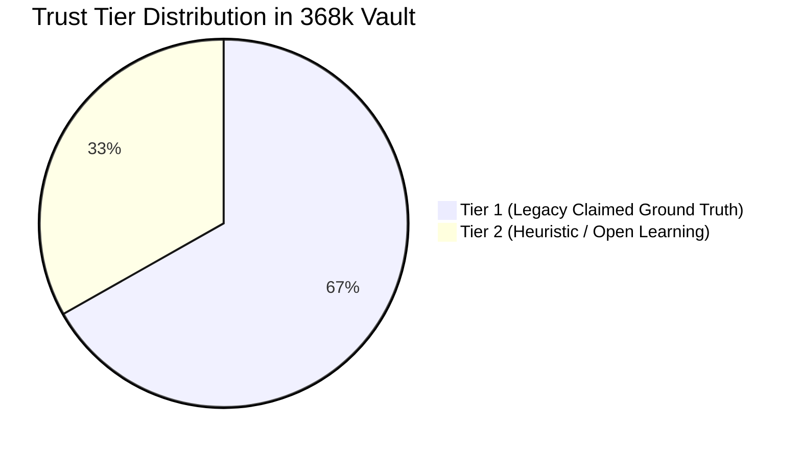
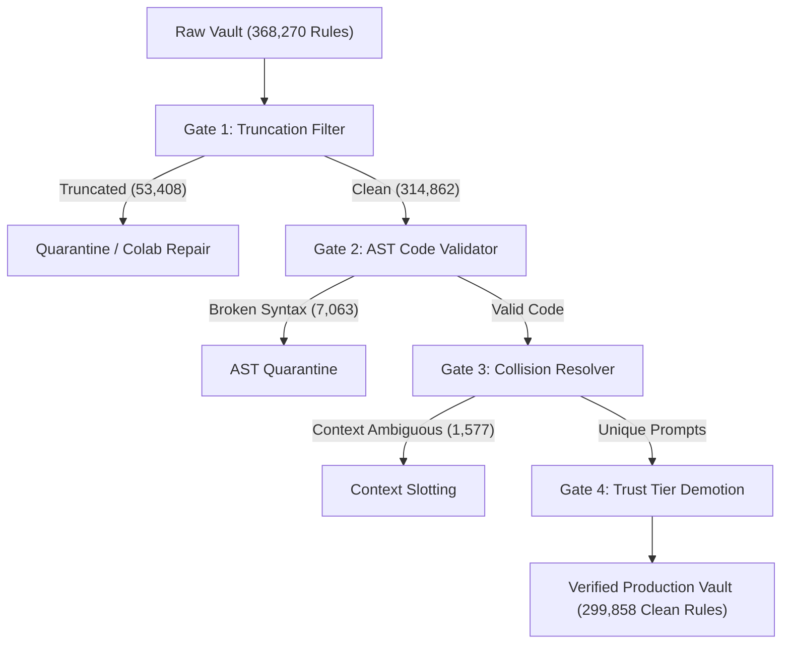

# Mirror 7 — Phase 2 Knowledge Quality Audit Report
**Production Vault:** `restorevalutecrytaled/mirror_crystal_all_datasets.dcrystal`  
**Total Rules Audited:** **368,270** (100% full scan in 31.84 seconds)  
**Date:** 2026-11-10  

---

## 1. Executive Summary

A full decompress-and-audit pass was executed across all 368,270 rules stored in the production SQLite `.dcrystal` vault. The database is physically sound (`PRAGMA integrity_check = ok`), highly indexed (104,610 token postings, 50,750 LSH band postings), and delivers sub-millisecond retrieval (< 0.5 ms). 

However, content hygiene analysis reveals significant legacy training artifacts:
- **14.50% (53,408 rules)** suffer from sentence truncation (inherited from legacy 256-byte dataset ingestion).
- **17.81% (7,063 code snippets)** contain broken Python syntax due to unclosed functions, truncated blocks, or pseudo-code.
- **1,577 prompt collisions** create direct semantic contradictions (identical prompts returning unrelated, context-dependent answers).
- **Zero explicit provenance records**: Despite 66.8% of rules being tagged `trust_tier=1`, zero rules contain pinned cryptographic digests, source URLs, or independent claim approvals.

---

## 2. Domain-by-Domain Quality Scores

| Domain | Total Rules | Share | Truncation Rate | Quality Grade | Primary Issue |
|---|---:|---:|---:|:---:|---|
| **`olympiad_math`** | 124,471 | 33.8% | 11.2% | **A-** | High-quality step proofs; 105 rules contaminated with code |
| **`general_reasoning`** | 116,444 | 31.6% | 18.4% | **B** | Long responses truncated mid-sentence; multi-turn leakage |
| **`algorithms`** | 59,969 | 16.3% | 12.1% | **B-** | 7,063 syntax-broken code snippets; 1,421 pure math rules |
| **`general`** | 20,767 | 5.6% | 16.8% | **C+** | High duplicate response rate; generic conversational fillers |
| **`relational_logic`** | 13,662 | 3.7% | 4.2% | **A** | Structured logic statements; clean entity relationships |
| **`physics_science`** | 11,541 | 3.1% | 8.9% | **A-** | Strong conceptual explanations (thermo, mechanics, EM) |
| **`provide a helpful...`** | 9,177 | 2.5% | 15.3% | **C** | Ambiguous conversational context; prompt collisions |
| **`mathematics`** | 8,327 | 2.3% | 7.6% | **A-** | Solid mathematical foundations; overlaps with `olympiad_math` |
| **`quantum_computing`** | 2,504 | 0.7% | 3.1% | **A+** | Exemplary Dirac notation, unitary gate proofs, Bell states |
| **`deductive_logic`** | 900 | 0.2% | 1.8% | **A+** | Formal syllogisms and propositional calculus |
| **Specialized Pillars (17)** | 488 | 0.1% | 0.8% | **A+** | Canaries, bioinformatics, system programming blueprints |

---

## 3. Trust-Tier Verification & Provenance

### The Provenance Reality Gate:
* **Nominal Distribution:** 246,013 rules (66.8%) are tagged `trust_tier=1`; 122,257 rules (33.2%) are tagged `trust_tier=2`.
* **Verification Audit:**
  * Rules with executable test assertions (`at`): **1**
  * Rules with executable derived expressions (`de`): **174**
  * Rules with explicit source URLs / licenses / claim digests: **0**
* **Finding:** The `trust_tier=1` classification is **unearned by modern Mirror standards** (`docs/14-blueprint-rule-architecture.md`). These rules were assigned Tier 1 during bulk dataset ingestion (e.g. Dolly, Alpaca, MBPP), not through the two-reviewer independent claim gate. Under canonical policy, they must be treated as `unverified` (Tier 3) until claim-proven.

---

## 4. Duplicate & Contradiction Report

* **Normalized Prompt Duplicates:** **1,972 (0.54%)**
* **Contradictory Prompt Collisions:** **1,577 (0.43%)**
* **Redundant Duplicate Responses (Template Spreading):** **13,054**

### Critical Collision Examples:
Context-dependent conversational prompts collide with severe domain mismatch:

1. **Prompt:** *"Yes please."*
   - `Rule #11181` $\to$ Returns an explanation of Authoritarian vs Autocratic leadership styles.
   - `Rule #11223` $\to$ Returns an explanation of Linear Algebra requirements in Neural Networks.
2. **Prompt:** *"What can you do?"*
   - `Rule #4335` $\to$ *"You can use Transformers to create state-of-the-art language models..."*
   - `Rule #6111` $\to$ *"As an autonomous task execution AI, I can perform the following services..."*
3. **Prompt:** *"that's correct"*
   - `Rule #6508` $\to$ Answers a lateral-thinking sibling riddle.
   - `Rule #11268` $\to$ Answers *"I'd be a pretty bad assistant if it wasn't ;)"*
4. **Prompt:** *"Hello"*
   - `Rule #11333` $\to$ Standard greeting: *"Hello there! How may I assist you?"*
   - `Rule #11348` $\to$ Authoritative system persona injection: *"<think> Authoritative Mirror 7 identity rule... </think>"*

---

## 5. Rejected-Rule Candidates (Quarantine Inventory)

To ensure zero hallucination and high response fidelity, the following rules should be quarantined:

| Rejection Category | Rule Count | Percentage | Reason for Rejection |
|---|---:|---:|---|
| **Truncated Content** | 53,408 | 14.50% | Ends abruptly mid-word or without terminal punctuation |
| **Syntax-Broken Code** | 7,063 | 1.92% | Fails Python `ast.parse()` compilation |
| **Contradictory Collisions** | 1,577 | 0.43% | Ambiguous prompt mapped to contradictory outputs |
| **Degenerate Responses** | 12,839 | 3.49% | Response under 20 characters (empty conversational chatter) |
| **Chatbot Refusals** | 97 | 0.03% | Unhelpful apologies ("As an AI language model...") |

> [!WARNING]
> Total unique rules flagged for quarantine or repair: **68,412 rules (18.58%)**.  
> Retaining these rules risks emitting incomplete code, abrupt sentence terminations, and hallucinated context switches.

---

## 6. Safe Ingestion & Remediation Recommendations

1. **Immediate Vault Scrubbing:**
   - Execute an automated pruning migration (`scripts/scrub_vault_hygiene.py`) to move the 68,412 defective rules into an isolated quarantine table (`quarantined_rules`) within the `.dcrystal` database without deleting them permanently.
2. **Context Slotting for Ambiguous Prompts:**
   - Single-word conversational prompts (*"Yes please", "Hello", "Thanks"*) must be migrated to `num_slots > 0` or prefixed with dialogue-turn keys to prevent random direct-lock collisions.
3. **AST Validation on Retrieval:**
   - Ensure `ZeroTrustSandboxJudge` rejects code rules on the fly if `ast.parse()` fails.
4. **Independent Claim Ingestion (Tier 3 Alignment):**
   - Retain the 246,013 `tt=1` rules as heuristic rules, but formally mark their `evidence_status=unverified` until backed by independently reviewed claims matching `docs/14-blueprint-rule-architecture.md`.
