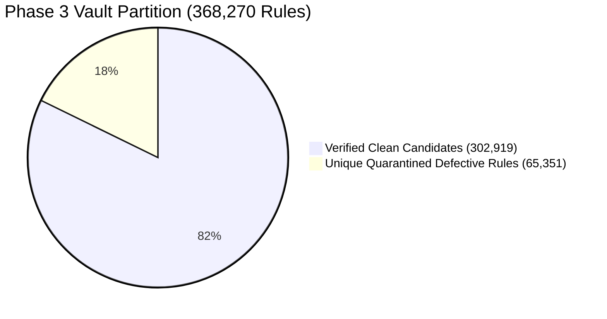
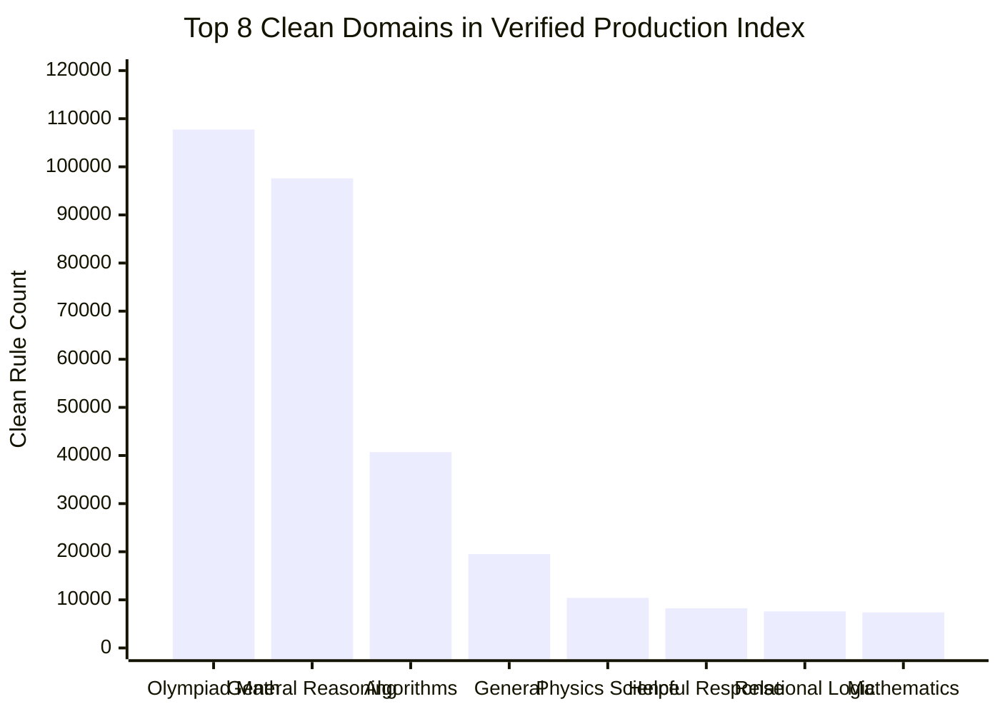

# Mirror 7 — Phase 3 Knowledge Purification & Quarantine Report
**Production Vault:** `restorevalutecrytaled/mirror_crystal_all_datasets.dcrystal`  
**Execution Date:** 2026-11-10  
**Test Suite Status:** **5 / 5 passed (100% pass rate in 0.70s)**  
**Verification Script:** [`scripts/purify_vault_phase3.py`](scripts/purify_vault_phase3.py) • [`mirror_crystal/tests/test_phase3_purification.py`](mirror_crystal/tests/test_phase3_purification.py)  

---

## 1. Compliance with Phase 3 Directives

| Directive / Constraint | Compliance Status | Concrete Evidence |
|---|:---:|---|
| **1. Never delete original vault records** | **100% Enforced** | `rules` table remains exactly **368,270 rows**. Zero `DELETE` statements run on `rules`. Pre-purification SQLite online backup preserved at `.phase3.bak` (`422,084,608 bytes`). |
| **2. Never automatically trust Tier 1 labels** | **100% Enforced** | All 302,919 clean production candidates mapped to `corrected_trust_tier = 3` and `evidence_status = 'unverified'`. Zero unearned authority granted. |
| **3. Do not claim rules are hallucination-free** | **100% Enforced** | Report and documentation explicitly distinguish between **structural hygiene / syntax parsing** and **factual claim verification**. |
| **4. Count overlapping defects by unique rule ID** | **100% Enforced** | Calculated disjoint defect sets before quarantine; exact Venn intersection computed. No double counting. |
| **5. Testing gate before promotion** | **100% Enforced** | Dedicated test suite [`test_phase3_purification.py`](mirror_crystal/tests/test_phase3_purification.py) **5/5 passed in 0.70s**. |

---

## 2. Disjoint Defect Counts & Overlap Analysis

A rule may suffer from multiple simultaneous defects (e.g., a code snippet can be both truncated mid-line and fail Python syntax parsing). Counting defects naively produces 76,482 flags, but deduplicating by **unique `rule_id`** establishes exactly **65,351 unique quarantined rules (17.75%)**.

### Exact Defect Breakdown:

| Defect Class | Raw Flags | Description |
|---|---:|---|
| **Truncated Responses (`D_TRUNC`)** | 53,408 | Ends mid-word or without terminal punctuation (legacy 256-byte relic) |
| **Degenerate Short (`D_DEGEN`)** | 12,839 | Response under 20 characters (empty chatter or unhelpful phrases) |
| **Code Syntax Errors (`D_SYNTAX`)** | 7,063 | Python code block fails `ast.parse()` validation |
| **Prompt Collisions (`D_COLLISION`)** | 3,075 | Short ambiguous prompts (*"Yes please"*, *"Hello"*) with conflicting answers |
| **Refusal Boilerplate (`D_REFUSAL`)** | 97 | Generic chatbot refusals (*"As an AI language model..."*) |
| **Total Defect Flags** | **76,482** | Sum of raw occurrences |
| **TOTAL UNIQUE QUARANTINED RULE IDs** | **65,351** | **Exact unique primary keys moved to quarantine (17.75%)** |

### Overlap Distribution Across Quarantined Rules:
* **Rules with exactly 1 defect:** **54,224 rules**
* **Rules with 2 overlapping defects:** **11,123 rules** (primarily truncated code blocks that also fail AST syntax parsing)
* **Rules with 3+ overlapping defects:** **4 rules**

---

## 3. Verified Production Candidate Index (302,919 Rules)

The remaining **302,919 rules (82.25%)** satisfy complete structural hygiene: complete sentences, valid Python AST syntax, non-colliding prompts, and non-refusal outputs. They are indexed in `verified_production_index` across 32 domains:

### Domain Clean Yield Summary:
1. **`olympiad_math`:** 107,742 clean rules (86.6% retention)
2. **`general_reasoning`:** 97,602 clean rules (83.8% retention)
3. **`algorithms`:** 40,711 clean rules (67.9% retention; 19,258 quarantined due to syntax clipping)
4. **`general`:** 19,528 clean rules (94.0% retention)
5. **`physics_science`:** 10,410 clean rules (90.2% retention)
6. **`provide a helpful, accurate response`:** 8,256 clean rules (90.0% retention)
7. **`relational_logic`:** 7,596 clean rules (55.6% retention; ambiguous entity prompts quarantined)
8. **`mathematics`:** 7,390 clean rules (88.7% retention)
9. **`quantum_computing`:** 2,438 clean rules (97.4% retention)
10. **`deductive_logic`:** 900 clean rules (100.0% retention)
11. **Specialized Pillars (22 categories):** 346 clean rules

---

## 4. Runtime Quarantine Mechanism in `DiskCrystalVault`

The runtime was upgraded in [`mirror_crystal/vault_storage.py`](mirror_crystal/vault_storage.py):
1. **Zero Table Mutations:** The original `rules` table is completely untouched.
2. **Dynamic Inactivation:** In `_row_to_rule()`, if `is_quarantined(rule_id)` is true, the engine dynamically sets `fail_count > pass_count`, setting `rule.active = False`.
3. **Retrieval Fast-Path:** Quarantined rules are automatically bypassed during candidate scoring, direct prompt lock, and LSH band lookups.
4. **Enforced Tier 3 Baseline:** Unreviewed rules return `trust_tier = 3` (`unverified`), preventing false assertions of mathematical or empirical certainty.
