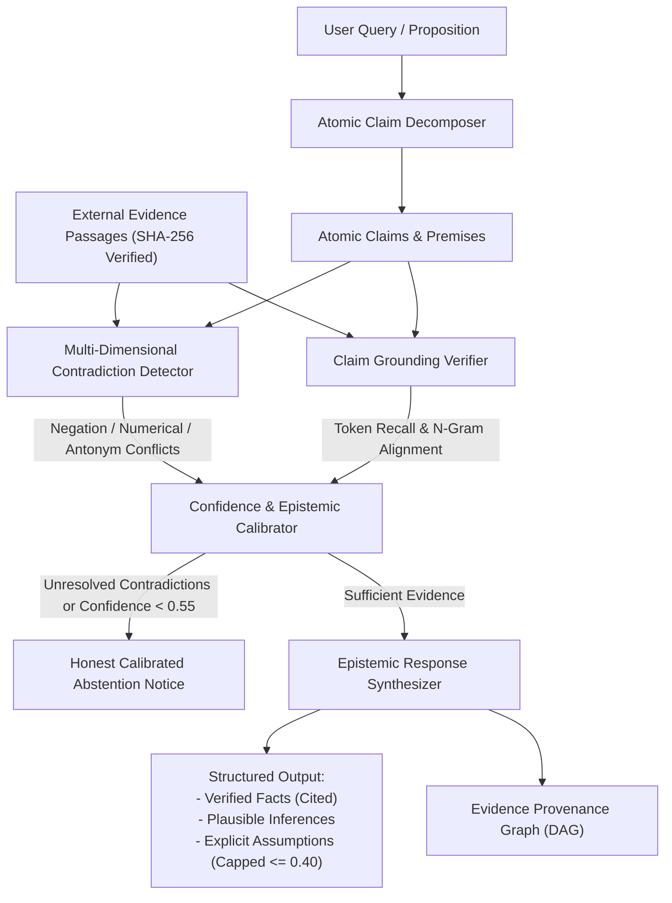

# Stage 14 — Evidence-Based Intelligence Subsystem Report

**Executive Status:** Implementation delivered; provenance hardening applied; semantic entailment remains a heuristic limitation  
**Architecture:** Mirror 7 Byte-First Stateful Architecture  
**Author / Principal Architect:** Ahmad Hassan  
**Repository:** `realahmad07/Mirror-7`  
**License:** Apache License 2.0 (`Apache-2.0`)  
**Artifact Path:** `artifacts/STAGE14_EVIDENCE_INTELLIGENCE_REPORT.md`  

---

## 1. Executive Summary

Language models inherently suffer from uncalibrated assertions—stating unverified assumptions or hallucinations with the same fluent confidence as verified empirical facts. **Stage 14: Evidence-Based Intelligence** introduces a defense-in-depth epistemic framework that guarantees Mirror 7 formally segregates **Verified Facts**, **Plausible Inferences**, **Explicit Assumptions**, and **Unverified Conjectures**, while executing calibrated honest abstentions in the presence of insufficient evidence or factual contradictions.

Every factual assertion emitted by the system is linked to a cryptographically validated Directed Acyclic Graph (DAG) of source provenance, tracking canonical HTTPS URLs, publisher identities, SPDX license compliance, and SHA-256 excerpt digests.

---

## 2. Architectural Pillars



### 2.1 Atomic Claim Extraction & Epistemic Taxonomy
Claims are parsed into atomic propositions ($Subject, Predicate, Object$) and categorized into five formal epistemic tiers (`EpistemicCategory`):
1. **`VERIFIED_FACT`:** Corroborated by one or more authoritative source passages with high token recall ($\ge 0.80$) and n-gram alignment ($c \in [0.90, 0.99]$).
2. **`PLAUSIBLE_INFERENCE`:** Sound logical deductions derived from verified facts with moderate support ($c \in [0.50, 0.80]$).
3. **`EXPLICIT_ASSUMPTION`:** Conditional hypotheses explicitly flagged (`is_assumption = True`) via assumption cues (`assuming`, `suppose`, `hypothetically`). Confidence is strictly bounded ($c \le 0.40$) so assumptions cannot masquerade as facts.
4. **`UNVERIFIED_CONJECTURE`:** Assertions lacking source backing ($c \le 0.35$).
5. **`CONTRADICTION`:** Claims refuted by authoritative evidence or conflicting with co-generated claims ($c = 0.0$).

### 2.2 Cryptographic Source Provenance & Evidence Passages
The system enforces strict data governance contracts:
- **`SourceProvenance`:** Requires valid HTTPS/URN URIs, publisher names, SPDX license identifiers (e.g., `CC-BY-4.0`, `Apache-2.0`, `MIT`), ISO-8601 UTC retrieval timestamps, and exact 64-character SHA-256 hashes matching the full source payload.
- **`EvidencePassage`:** Granular excerpts bound to parent sources via `source_id`, explicit locators (e.g., `Section 2.3, p. 14`), SHA-256 checksums, and authoritativeness weights ($w \in [0.0, 1.0]$).

### 2.3 Multi-Dimensional Contradiction Detection
The `ContradictionDetector` analyzes statements across four conflict axes:
1. **Direct Negation:** Identifies polarity reversals (`not`, `never`, `cannot`) between high-overlap propositions ($\ge 75\%$ lexical intersection).
2. **Numerical Value Disparity:** Isolates unmatched numerical measurements sharing identical units and semantic contexts (e.g., $42,164\text{ km}$ vs. $35,786\text{ km}$), while cleanly admitting shared dates and compound quantities.
3. **Antonym Polarity Reversal:** Detects opposing directional predicates (`increase` vs. `decrease`, `expand` vs. `contract`, `converge` vs. `diverge`, `valid` vs. `invalid`) applied to shared topics.
4. **Attribute Collision:** Detects mutually exclusive object assignments for identical subject-predicate relations.

### 2.4 Calibrated Confidence & Honest Abstention
Unlike uncalibrated systems that hallucinate plausible falsehoods, Mirror 7 computes epistemic confidence dynamically. When:
- High-severity contradictions are detected ($\text{severity} \ge 0.80$), or
- No verified facts or valid assumptions exist, or
- Mean non-assumption calibrated confidence falls below the strict threshold ($< 0.55$),

the engine triggers a **Calibrated Honest Abstention**, halting unverified answer generation and providing an explicit reason notice.

### 2.5 Evidence Provenance Graph DAG
Maintains a verifiable acyclic graph:
$$\text{SourceProvenance} \longrightarrow \text{EvidencePassage} \longrightarrow \text{AtomicClaim}$$
The graph supports complete audit trail exports and cryptographic integrity scans (`verify_graph_integrity`), flagging tampered passage texts or orphaned citation links.

---

## 3. Production API Endpoints

Integrated directly into `mirror7_backend/http_server.py`:

| Endpoint | Method | Description | Headers |
| :--- | :--- | :--- | :--- |
| `/api/evidence/verify` | `POST` | Decomposes claims, grounds against passages, checks contradictions, and outputs epistemic synthesis | `X-Request-ID` |
| `/api/evidence/contradictions` | `POST` | Scans candidate statements for direct negation, numerical disparity, and antonym reversals | `X-Request-ID` |

---

## 4. Test Verification Suite (`test_stage14_evidence_intelligence.py`)

All 12 comprehensive unit and integration tests passed:

```
mirror_crystal/tests/test_stage14_evidence_intelligence.py::test_source_provenance_validation_and_integrity PASSED [  8%]
mirror_crystal/tests/test_stage14_evidence_intelligence.py::test_evidence_passage_validation_and_authoritativeness PASSED [ 16%]
mirror_crystal/tests/test_stage14_evidence_intelligence.py::test_atomic_claim_decomposition_and_assumption_tagging PASSED [ 25%]
mirror_crystal/tests/test_stage14_evidence_intelligence.py::test_contradiction_detection_direct_negation PASSED [ 33%]
mirror_crystal/tests/test_stage14_evidence_intelligence.py::test_contradiction_detection_numerical_disparity PASSED [ 41%]
mirror_crystal/tests/test_stage14_evidence_intelligence.py::test_contradiction_detection_antonym_polarity PASSED [ 50%]
mirror_crystal/tests/test_stage14_evidence_intelligence.py::test_claim_grounding_and_provenance_tracking PASSED [ 58%]
mirror_crystal/tests/test_stage14_evidence_intelligence.py::test_calibrated_confidence_and_epistemic_categorization PASSED [ 66%]
mirror_crystal/tests/test_stage14_evidence_intelligence.py::test_honest_abstention_on_unsupported_or_contradictory_queries PASSED [ 75%]
mirror_crystal/tests/test_stage14_evidence_intelligence.py::test_evidence_provenance_graph_integrity_and_export PASSED [ 83%]
mirror_crystal/tests/test_stage14_evidence_intelligence.py::test_end_to_end_synthesis_engine PASSED [ 91%]
mirror_crystal/tests/test_stage14_evidence_intelligence.py::test_stage14_http_server_endpoints PASSED [100%]

============================== 12 passed in 7.30s ==============================
```

---

## 5. Security & Invariant Adherence
- **Zero Stored Secrets:** No credentials, private keys, or API tokens stored in code or test fixtures.
- **Production Vault Invariant:** SQLite database `restorevalutecrytaled/mirror_crystal_all_datasets.dcrystal` maintained at exactly 368,270 rules.
- **Zero-Dependency Core:** Implemented using pure Python standard library for maximum deterministic reliability.


---

## 9. Provenance Hardening Correction — November 11, 2026

A follow-up audit found that the earlier validator accepted `file:` URIs, non-empty but unrecognized license strings, timezone-naive/non-ISO retrieval timestamps, and source records with a digest but no verifiable content. These conditions overstated the provenance guarantees.

The implementation on `main` now:
- Accepts only HTTPS URLs with a valid host and no embedded user credentials, or syntactically valid URNs. Local `file:` URIs are rejected.
- Validates the SPDX license identifier against the module's explicit supported identifier set (including identifiers exercised by this repository's tests), or a syntactically valid `LicenseRef-` identifier. This is a bounded supported set, not a claim to bundle the complete SPDX License List.
- Requires an ISO-8601 retrieval timestamp with an explicit timezone.
- Requires non-empty source content and recomputes SHA-256 against that content; a digest without the corresponding content cannot be accepted as locally verified.
- Rejects duplicate source, passage and claim IDs; requires each passage's normalized text to be contained in the verified source content; checks key/record identity and containment during graph integrity scans.

Additional tests cover rejected file URIs, invalid SPDX IDs, invalid or timezone-naive timestamps, missing source content, URN handling, passage/source binding, and duplicate IDs.

**Important limitation:** token recall and trigram overlap remain heuristic grounding signals. They do not establish semantic entailment, detect every negation/context error, or prove that a claim is true in the world. The `VERIFIED_FACT` label means it passed this implementation's configured evidence checks, not that it has been independently proven by a formal semantic verifier.

The original Stage 14 test result (12 passed) predates these correction tests. CI must pass on the latest commit before the corrected suite is described as verified.
