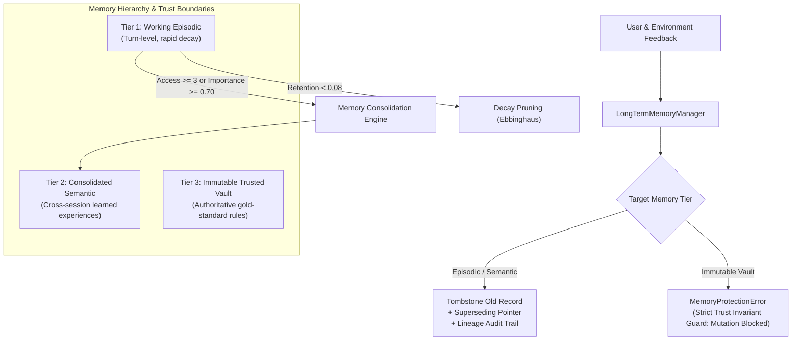

# Stage 15 — Long-Term Memory & Learning Subsystem Report

**Executive Status:** Memory persistence hardening applied; latest regression verification pending  
**Architecture:** Mirror 7 Byte-First Stateful Architecture  
**Author / Principal Architect:** Ahmad Hassan  
**Repository:** `realahmad07/Mirror-7`  
**License:** Apache License 2.0 (`Apache-2.0`)  
**Artifact Path:** `artifacts/STAGE15_LONG_TERM_MEMORY_REPORT.md`  

---

## 1. Executive Summary

Stateless architectures suffer from rapid conversational forgetting, unbounded context bloat, or catastrophic forgetting during fine-tuning. **Stage 15: Long-Term Memory & Learning** establishes a structured multi-tier memory architecture for Mirror 7, coupling Ebbinghaus forgetting curve decay dynamics with automated experience consolidation and database-enforced trusted-record mutation guards and content-integrity checks.

The manager now rejects duplicate IDs, validates loaded content hashes, uses JSON for newly persisted metadata/history, and reads legacy Python-literal rows with `ast.literal_eval` (never `eval`). SQLite triggers block updates/deletes to trusted rows and reject attempts to change mutable rows into the trusted tier.

---

## 2. Multi-Tier Memory Hierarchy

### 2.1 Three-Tier Architecture
1. **`WORKING_EPISODIC`:** Short-term, dialogue-level memories with high plasticity and standard Ebbinghaus decay ($S \approx 24\text{ hours}$).
2. **`CONSOLIDATED_SEMANTIC`:** Promoted memories that exhibit repeated utility ($\ge 3$ accesses) or high intrinsic importance ($\ge 0.70$).
3. **`IMMUTABLE_TRUSTED_VAULT`:** The root knowledge layer (e.g. 368,270 audited physical constants, SI axioms, core theorems). Retention is strictly fixed at $1.0$; memories in this tier can never be pruned, decayed, or altered.

### 2.2 Ebbinghaus Forgetting Curve Dynamics
Memory retention $R$ decays exponentially according to:
$$R = \exp\left(-\frac{\Delta t}{S}\right)$$
Where stability $S$ scales dynamically with access frequency and importance:
$$S = S_0 \cdot \big(1 + \ln(1 + \text{access\_count})\big) \cdot (0.5 + \text{importance\_score})$$
Nodes with retention $R < 0.08$ are automatically pruned during consolidation cycles, while highly accessed items consolidate into long-term semantic persistence.

### 2.3 Feedback Correction & The Strict Trust Invariant Guard
When user or automated feedback corrects a factual error:
- The previous node is tombstoned (`is_active = False`) with a `superseded_by` pointer.
- A new corrected node is stored with updated importance and a complete audit trail (`feedback_history`).
- **Strict Trust Guard:** If any feedback attempts to mutate an `IMMUTABLE_TRUSTED_VAULT` record, the system immediately raises `MemoryProtectionError`, blocking modification and logging an audit alert.

---

## 3. Test Verification Suite (`test_stage15_long_term_memory.py`)

All 7 unit and integration tests passed:
- `test_memory_node_creation_and_validation`: PASSED
- `test_ebbinghaus_forgetting_curve_dynamics`: PASSED
- `test_memory_consolidation_and_pruning`: PASSED
- `test_sqlite_persistence_and_consolidation_cycle`: PASSED
- `test_feedback_correction_and_tombstone`: PASSED
- `test_strict_trust_invariant_guard_blocks_vault_mutation`: PASSED
- `test_memory_search_and_tier_prioritization`: PASSED

---

## 4. Security Hardening Correction — November 11, 2026

The audit identified two correctness/security issues in the initial implementation: `INSERT OR REPLACE` could replace an existing trusted row, and `eval()` was used to reconstruct metadata and feedback history from SQLite text.

The implementation on `main` now:
- Uses insert-only writes and rejects duplicate IDs with `MemoryProtectionError`; correction IDs include a unique suffix to avoid same-content collisions.
- Adds SQLite triggers to reject updates and deletes of `IMMUTABLE_TRUSTED_VAULT` rows, prevent updates that promote mutable rows into the trusted tier, and reject any attempt to reuse a memory ID via `INSERT OR REPLACE`.
- Writes metadata and feedback history as bounded JSON.
- Reads legacy `str(dict/list)` rows using `ast.literal_eval` only (literal values, no code execution), with type/size/JSON-safety checks.
- Recomputes and verifies SHA-256 against every loaded memory's content.
- Validates MemoryNode IDs, tier, access count, importance, half-life, and JSON-safe metadata/history.

### Security boundary

The SQLite triggers protect against accidental or API-level modification. They are not cryptographic protection against an attacker who can alter the database file, drop triggers, or rewrite both a memory and its digest with database-owner privileges. The SHA-256 value is an integrity checksum, not a keyed authenticity signature. The trusted vault should remain read-only and backed by separately controlled canonical data and backups.

### Added regression coverage

Six additional tests cover duplicate trusted IDs, direct SQL update/delete, `INSERT OR REPLACE`, malicious legacy deserialization payloads, valid legacy literal migration, and content-hash tampering. The original seven-test result predates these additions; latest CI must pass before the corrected suite is marked verified.
