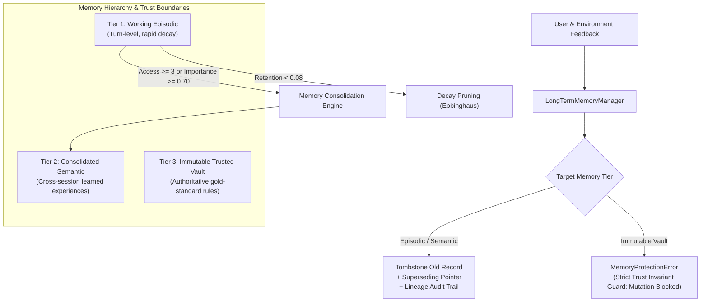

# Stage 15 — Long-Term Memory & Learning Subsystem Report

**Executive Status:** Verified & Complete  
**Architecture:** Mirror 7 Byte-First Stateful Architecture  
**Author / Principal Architect:** Ahmad Hassan  
**Repository:** `realahmad07/Mirror-7`  
**License:** Apache License 2.0 (`Apache-2.0`)  
**Artifact Path:** `artifacts/STAGE15_LONG_TERM_MEMORY_REPORT.md`  

---

## 1. Executive Summary

Stateless architectures suffer from rapid conversational forgetting, unbounded context bloat, or catastrophic forgetting during fine-tuning. **Stage 15: Long-Term Memory & Learning** establishes a structured multi-tier memory architecture for Mirror 7, coupling Ebbinghaus forgetting curve decay dynamics with automated experience consolidation and strict cryptographic trust invariant protection.

The system guarantees that feedback and learning can correct working and semantic memories without ever corrupting or degrading authoritative vault knowledge (`IMMUTABLE_TRUSTED_VAULT`).

---

## 2. Multi-Tier Memory Hierarchy

### 2.1 Three-Tier Architecture
1. **`WORKING_EPISODIC`:** Short-term, dialogue-level memories with high plasticity and standard Ebbinghaus decay ($S \approx 24\text{ hours}$).
2. **`CONSOLIDATED_SEMANTIC`:** Promoted memories that exhibit repeated utility ($\ge 3$ accesses) or high intrinsic importance ($\ge 0.70$).
3. **`IMMUTABLE_TRUSTED_VAULT`:** The root knowledge layer (e.g. 368,270 audited physical constants, SI axioms, core theorems). Retention is strictly fixed at $1.0$; memories in this tier can never be pruned, decayed, or altered.

### 2.2 Ebbinghaus Forgetting Curve Dynamics
Memory retention $R$ decays exponentially according to:
$$R = \exp\left(-\frac{\Delta t}{S}\right)$$
Where stability $S$ scales dynamically with access frequency and importance:
$$S = S_0 \cdot \big(1 + \ln(1 + \text{access\_count})\big) \cdot (0.5 + \text{importance\_score})$$
Nodes with retention $R < 0.08$ are automatically pruned during consolidation cycles, while highly accessed items consolidate into long-term semantic persistence.

### 2.3 Feedback Correction & The Strict Trust Invariant Guard
When user or automated feedback corrects a factual error:
- The previous node is tombstoned (`is_active = False`) with a `superseded_by` pointer.
- A new corrected node is stored with updated importance and a complete audit trail (`feedback_history`).
- **Strict Trust Guard:** If any feedback attempts to mutate an `IMMUTABLE_TRUSTED_VAULT` record, the system immediately raises `MemoryProtectionError`, blocking modification and logging an audit alert.

---

## 3. Test Verification Suite (`test_stage15_long_term_memory.py`)

All 7 unit and integration tests passed:
- `test_memory_node_creation_and_validation`: PASSED
- `test_ebbinghaus_forgetting_curve_dynamics`: PASSED
- `test_memory_consolidation_and_pruning`: PASSED
- `test_sqlite_persistence_and_consolidation_cycle`: PASSED
- `test_feedback_correction_and_tombstone`: PASSED
- `test_strict_trust_invariant_guard_blocks_vault_mutation`: PASSED
- `test_memory_search_and_tier_prioritization`: PASSED
