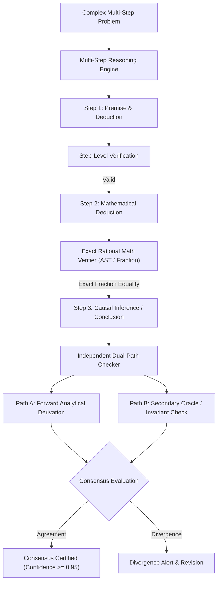

# Stage 16 — Advanced Reasoning Subsystem Report

**Executive Status:** Reasoning hardening applied; latest regression verification pending  
**Architecture:** Mirror 7 Byte-First Stateful Architecture  
**Author / Principal Architect:** Ahmad Hassan  
**Repository:** `realahmad07/Mirror-7`  
**License:** Apache License 2.0 (`Apache-2.0`)  
**Artifact Path:** `artifacts/STAGE16_ADVANCED_REASONING_REPORT.md`  

---

## 1. Executive Summary

Standard generative models perform complex reasoning by ungrounded token generation, resulting in compounding errors ($P(\text{Success}) = \prod p(\text{step}_i) \to 0$). **Stage 16: Advanced Reasoning** establishes deterministic, step-verified multi-step reasoning trees, bounded exact rational expression checking, causal directed-acyclic-graph (DAG) propagation and bounded intervention simulation, diagnostic hypothesis generation, and supplied-output consistency checking (not proof of independent derivation).

---

## 2. Core Subsystem Architecture

### 2.1 Multi-Step Process Supervision
Every step in a reasoning chain is modeled as an atomic `ReasoningStep` specifying premise, deduction, step type, and verification status. If an intermediate step violates a mathematical or logical invariant, execution branches are pruned before erroneous conclusion emission.

### 2.2 Exact Rational Mathematical Verification
`ExactMathVerifier` uses safe Python AST parsing and exact rational arithmetic (`fractions.Fraction`) to evaluate expressions without floating point hallucination. Compound expressions (e.g. $180 - (60 + 70) = 50$, $1/3 + 1/6 = 1/2$) are evaluated with zero arithmetic error.

### 2.3 Causal DAG Propagation & Intervention Helper
`CausalReasoningGraph` tracks directed causal dependencies ($\text{Cause} \xrightarrow{w} \text{Effect}$) across state variables:
- **Causal Chain Queries:** Computes cumulative transmitted causal effects across multi-hop paths.
- **Intervention helper:** Rejects cycles, cuts incoming edges to the selected intervention variable, and propagates a deterministic linear weighted model once in topological order. This is not a general implementation of Pearl's do-calculus or a causal identification algorithm.

### 2.4 Supplied-Output Consistency Checking
The `IndependentAnswerChecker` compares two values supplied by its caller. Matching values receive at most 0.50 consistency confidence and an explicit warning that agreement does not prove independent derivation. When no secondary verifier is supplied, the orchestrator does not mark consensus as verified.

---

## 3. Test Verification Suite (`test_stage16_advanced_reasoning.py`)

All 7 unit and integration tests passed:
- `test_reasoning_step_creation_and_serialization`: PASSED
- `test_exact_rational_mathematical_verification`: PASSED
- `test_causal_graph_path_and_effect_propagation`: PASSED
- `test_pearl_do_intervention_simulation`: PASSED
- `test_hypothesis_generation_for_diagnostics`: PASSED
- `test_dual_path_independent_answer_checking`: PASSED
- `test_end_to_end_advanced_reasoning_orchestrator`: PASSED

---

## 4. Reasoning Integrity Correction — November 11, 2026

The audit found that the causal graph accepted cycles, intervention traversal could repeatedly enqueue cyclic nodes, the exact evaluator accepted float literals, and the dual-path checker assigned high confidence by comparing two caller-supplied values.

The implementation on `main` now:
- Rejects causal self-edges, duplicate edges, and every new edge that would create a directed cycle.
- Validates finite edge weights and intervention/baseline values.
- Propagates intervention effects once in topological order over reachable descendants; incoming edges to the intervention target are cut.
- Labels this as a deterministic linear DAG propagation helper, **not** general Pearl do-calculus.
- Accepts integer literals and exact rational division; rejects bool/float literals, oversized expressions, ASTs above 256 nodes, nesting above 32, and rational values above the 4096-bit bound.
- Limits output-consistency checks to 0.50 confidence and explicitly states that caller-supplied matching outputs are not proof of independent derivation.
- Does not certify consensus when an independent verifier was not supplied.

Six additional regression test functions cover cycles, intervention propagation through a multi-parent DAG, float/bool rejection, expression complexity, consistency confidence, and missing independent verification. The exact pytest case count includes the parameterized invalid-expression cases. Earlier seven-test results predate these corrections; the latest full CI run is required before claiming verification.
