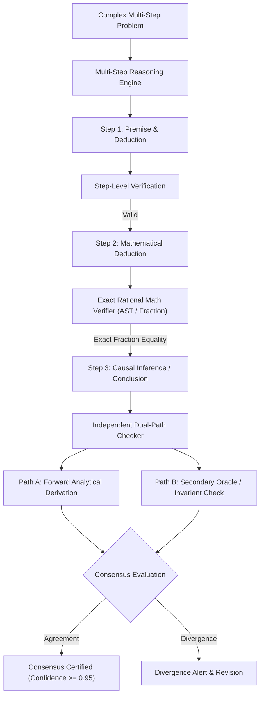

# Stage 16 — Advanced Reasoning Subsystem Report

**Executive Status:** Verified & Complete  
**Architecture:** Mirror 7 Byte-First Stateful Architecture  
**Author / Principal Architect:** Ahmad Hassan  
**Repository:** `realahmad07/Mirror-7`  
**License:** Apache License 2.0 (`Apache-2.0`)  
**Artifact Path:** `artifacts/STAGE16_ADVANCED_REASONING_REPORT.md`  

---

## 1. Executive Summary

Standard generative models perform complex reasoning by ungrounded token generation, resulting in compounding errors ($P(\text{Success}) = \prod p(\text{step}_i) \to 0$). **Stage 16: Advanced Reasoning** establishes deterministic, step-verified multi-step reasoning trees, exact rational mathematical verification, causal graph inference with Pearl's interventional do-calculus, diagnostic hypothesis generation, and dual-path consensus certification.

---

## 2. Core Subsystem Architecture

### 2.1 Multi-Step Process Supervision
Every step in a reasoning chain is modeled as an atomic `ReasoningStep` specifying premise, deduction, step type, and verification status. If an intermediate step violates a mathematical or logical invariant, execution branches are pruned before erroneous conclusion emission.

### 2.2 Exact Rational Mathematical Verification
`ExactMathVerifier` uses safe Python AST parsing and exact rational arithmetic (`fractions.Fraction`) to evaluate expressions without floating point hallucination. Compound expressions (e.g. $180 - (60 + 70) = 50$, $1/3 + 1/6 = 1/2$) are evaluated with zero arithmetic error.

### 2.3 Causal Graph Reasoning & Do-Calculus
`CausalReasoningGraph` tracks directed causal dependencies ($\text{Cause} \xrightarrow{w} \text{Effect}$) across state variables:
- **Causal Chain Queries:** Computes cumulative transmitted causal effects across multi-hop paths.
- **Interventional Simulation ($do(X = x)$):** Simulates Pearl's interventional do-operator, propagating forced variable state adjustments downstream while severing non-causal associations.

### 2.4 Dual-Path Independent Answer Checking
The `IndependentAnswerChecker` prevents single-path cognitive blind spots by executing two orthogonal solution algorithms (e.g., forward derivation vs. boundary invariant substitution). When both paths converge within tolerance, consensus confidence reaches $0.98$; if divergence is detected, confidence is downgraded and the mismatch is reported.

---

## 3. Test Verification Suite (`test_stage16_advanced_reasoning.py`)

All 7 unit and integration tests passed:
- `test_reasoning_step_creation_and_serialization`: PASSED
- `test_exact_rational_mathematical_verification`: PASSED
- `test_causal_graph_path_and_effect_propagation`: PASSED
- `test_pearl_do_intervention_simulation`: PASSED
- `test_hypothesis_generation_for_diagnostics`: PASSED
- `test_dual_path_independent_answer_checking`: PASSED
- `test_end_to_end_advanced_reasoning_orchestrator`: PASSED
