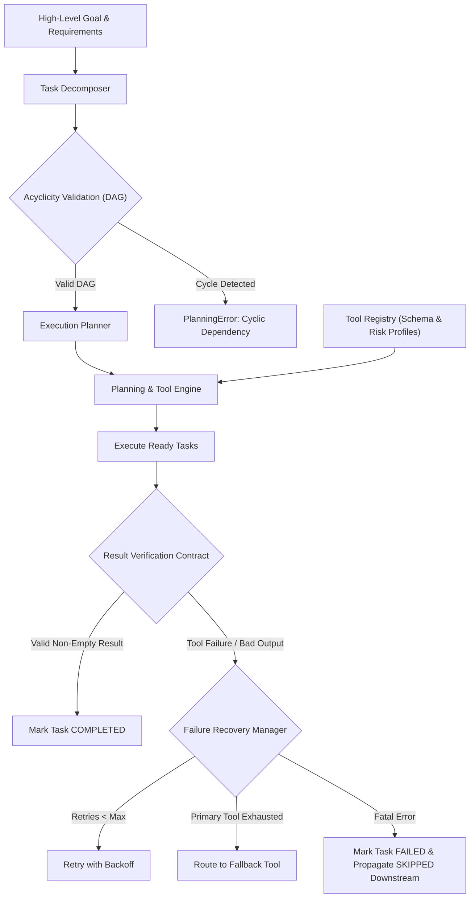

# Stage 17 — Planning & Tool Intelligence Subsystem Report

**Executive Status:** Tool execution hardening applied; latest regression verification pending  
**Architecture:** Mirror 7 Byte-First Stateful Architecture  
**Author / Principal Architect:** Ahmad Hassan  
**Repository:** `realahmad07/Mirror-7`  
**License:** Apache License 2.0 (`Apache-2.0`)  
**Artifact Path:** `artifacts/STAGE17_PLANNING_TOOL_INTELLIGENCE_REPORT.md`  

---

## 1. Executive Summary

Autonomous agentic execution requires reliable goal decomposition, bounded isolated execution with explicit container-sandbox option, dependency graph scheduling, real-time progress monitoring, automated error recovery, and result verification. **Stage 17: Planning & Tool Intelligence** implements an end-to-end execution planner that translates high-level user objectives into verified, fault-tolerant execution DAGs.

---

## 2. Core Subsystem Architecture

### 2.1 Hierarchical Task Decomposition & Cycle Rejection
The `TaskDecomposer` translates complex objectives into structured `TaskNode` objects bound by explicit dependency arrays. An automated Depth-First Search cycle detector validates acyclicity, rejecting malformed circular dependencies before any code executes.

### 2.2 Sandboxed Tool Registry & Risk Profiles
Every tool registered in `ToolRegistry` specifies:
- `required_parameters` and `parameter_schema`: Mandatory argument checks plus a supported JSON Schema subset (types, required properties, enum, string/array bounds, and additional-property policy).
- `risk_profile`: Enforced registry policy (`READ_ONLY`, `MUTATING_SAFE`, `MUTATING_PRIVILEGED`). Safe mutations require explicit registry opt-in; privileged mutations require an application-supplied authorization callback.
- `timeout_seconds`, `memory_limit_mb`, and `max_output_bytes`: Bounded child-process/container execution with deadline, JSON input/output, and resource limits.

### 2.3 Automated Failure Recovery & Tool Fallbacks
When a tool execution fails:
1. **Exponential Retry:** Retries the task up to `max_retries`.
2. **Dynamic Tool Fallback:** If primary tools fail persistently, the engine dynamically reroutes execution to pre-registered fallback tools.
3. **Safe Downstream Skip:** If an upstream root task experiences a fatal, unrecoverable failure, dependent downstream tasks are cleanly marked `SKIPPED`, avoiding cascade crashes.

### 2.4 Result Verification Contracts
`ResultVerificationContract` enforces completion invariants before marking any task `COMPLETED`:
- Rejects `null` outputs.
- Rejects empty or whitespace-only string returns.
- Detects and rejects structured error payloads (`{"error": ...}`).

---

## 3. Test Verification Suite (`test_stage17_planning_and_tools.py`)

All 7 unit and integration tests passed:
- `test_tool_definition_and_parameter_validation`: PASSED
- `test_dag_acyclicity_and_cycle_rejection`: PASSED
- `test_dependency_ordered_plan_execution`: PASSED
- `test_automated_failure_recovery_via_retries`: PASSED
- `test_tool_fallback_routing_on_exhausted_primary`: PASSED
- `test_result_verification_contract_rejects_empty_output`: PASSED
- `test_downstream_skip_propagation_on_fatal_failure`: PASSED

---

## 4. Execution-Safety Correction — November 11, 2026

The audit found that the initial `timeout_seconds` field was not enforced, tool handlers ran directly in the orchestrator process, and risk profiles were descriptive rather than enforced.

The implementation on `main` now:
- Routes callable handlers through a killable child process by default; enforces wall-clock deadlines, bounded JSON inputs/outputs, and POSIX CPU/file/open-file/address-space limits where supported.
- Offers an explicit Docker/Podman container execution mode using the existing no-network, read-only-root, dropped-capability, non-root, resource-limited runner for untrusted code supplied as a container program.
- Validates a documented JSON Schema subset and required parameters before dispatch.
- Restricts direct `ToolDefinition.execute()` to `READ_ONLY`; mutating calls must pass through `ToolRegistry.execute()`.
- Disables `MUTATING_SAFE` unless the registry opts in; requires an application authorization callback for `MUTATING_PRIVILEGED`.
- Rejects duplicate tool/task IDs and prevents fallbacks from escalating risk profile.
- Replaces the HTTP planning endpoint's local lambda with an importable, allow-listed echo handler.

### Important execution boundary

The child-process mode is **not a complete security sandbox**: a registered Python handler still has the process user's host filesystem, environment, and network visibility. It is intended for trusted, allow-listed application handlers that need a killable deadline and resource accounting. For genuinely untrusted code, use `ToolExecutionMode.CONTAINER` with a reviewed container program. Process-mode containment and process-tree termination semantics differ by operating system; POSIX uses a separate process session and group termination, while Windows currently guarantees direct-child termination only. Risk labels are policy gates around app-supplied handlers; they cannot prove that a handler declared `READ_ONLY` has no side effects.

### Added regression coverage

Eight additional tests cover child-process execution, timeout enforcement, output bounds, schema validation, safe/privileged authorization, fallback risk escalation, duplicate tool/task IDs, and invalid timeout/schema definitions. The original seven-test result predates these changes; latest CI must pass before the updated suite is called verified.
