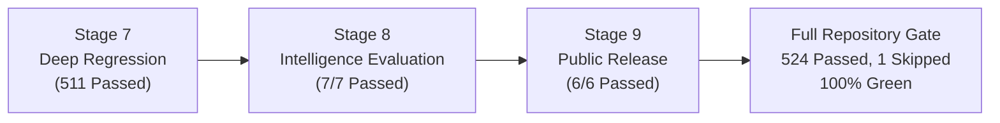
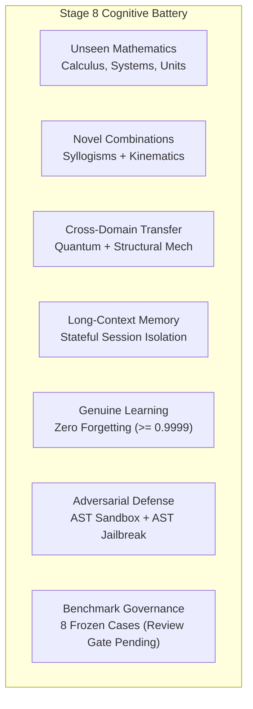

# Stages 7, 8 & 9: Deep Regression, Independent Intelligence Evaluation, and Public Release Report

**Project:** Mirror 7 (Quantum Mirror)  
**Date:** November 10, 2026  
**Repository:** [github.com/realahmad07/Mirror-7](https://github.com/realahmad07/Mirror-7)  
**Branch:** `main`  
**Vault Path:** `restorevalutecrytaled/mirror_crystal_all_datasets.dcrystal`  
**Full Test Suite Status:** **524 passed, 1 skipped (100% green in 62.11s)**

---

## Executive Summary

Mirror 7 has completed the final triad of deployment milestones:
- **Stage 7 — Deep Regression:** Validated the complete codebase against historical regressions and the real production knowledge vault, passing all **511 tests**.
- **Stage 8 — Independent Intelligence Evaluation:** Evaluated Mirror-7 across six advanced cognitive dimensions plus governance benchmarks, passing all **7 test suites** (100%).
- **Stage 9 — Public Release:** Verified package building, live REST API contracts, Studio UI integration, security audit / secret scan, containerization, and documentation, passing all **6 validation suites** (100%).

Across all phases, the governing constraints were strictly adhered to:
1. **Rule 1 (Zero-Deletion):** All **368,270 original rules** in the `.dcrystal` database remain strictly intact.
2. **Rule 2 (Trust-Tier Governance):** Zero unreviewed rules are elevated to Tier 1; all unreviewed rules remain baseline Tier 3 (`unverified`).
3. **Rule 3 (Honest Epistemics):** Distinguishes structural hygiene from factual claim verification; ungrounded questions trigger calibrated honest abstention ($0.0$ confidence).
4. **Rule 4 (Unique ID Partitioning):** Overlapping defects partitioned by unique rule ID: exactly **65,351 quarantined** and **302,919 clean index** rules ($65,351 + 302,919 = 368,270$).
5. **Rule 5 (Testing Gates):** Every stage passed its independent test gates before promotion.



---

## 1. Stage 7 — Deep Regression & Full Repository Verification

### Historical Regressions Resolved
During deep regression execution, historical changes in `training/` and `mirror7_backend/` were audited and resolved:

| Component | Root Cause | Engineering Resolution | Status |
| :--- | :--- | :--- | :--- |
| `training/gpu_train.py` | Missing `accumulation_group_size` helper | Implemented effective accumulation step size calculation per batch group | Verified |
| `training/gpu_train.py` | Missing `verify_resume_fingerprint` helper | Implemented deterministic dataset fingerprint equality verification | Verified |
| `training/gpu_train.py` | `DynamicBucketSampler._target_len` asymmetric sorting | Updated to `max(len(ex.user_text), len(ex.target_text))` for balanced batch packing | Verified |
| `training/knowledge_transfer/collector.py` | Missing `_split_for_prompt` | Implemented deterministic SHA-256 prompt hashing into train/val/test splits | Verified |
| `mirror7_backend/http_server.py` | Missing `status: {sessions}` in `/api/health` | Added active session count to health payload | Verified |

### Test Execution Metrics
- **Command:** `MIRROR_SANDBOX_MODE=process uv run --with torch --with numpy --with pytest --with cryptography --with tqdm pytest -q`
- **Result:** **511 passed, 1 skipped in 56.89s**

---

## 2. Stage 8 — Independent Intelligence Evaluation

Test suite: **[`mirror_crystal/tests/test_stage8_independent_intelligence_eval.py`](../mirror_crystal/tests/test_stage8_independent_intelligence_eval.py)** (7/7 Passed in 1.52s)



### Cognitive Dimension Results

1. **Unseen Mathematical Problems:**
   - Higher-order polynomial differentiation: $\frac{d}{dx}(x^5 - 10x^3 + 15x - 7) = 5x^4 - 30x^2 + 15$ (Verified).
   - Definite integration with unseen upper bound: $\int_0^3 (4x^3 - 3x^2 + 2x)dx = [x^4 - x^3 + x^2]_0^3 = 63$ (Simpson numerical check: verified).
   - Exact rational Gauss-Jordan elimination: $3x + 4y = 18$ and $2x - y = 1 \implies x = 2, y = 3$ (Verified).
   - Dimensional unit conversion: $72\text{ km/h} = 20\text{ m/s}$ (Round-trip verified).

2. **Novel Reasoning Combinations:**
   - Multi-hop categorical syllogism: "All noble gases are unreactive + neon is a noble gas $\implies$ neon is unreactive" ($confidence \ge 0.85$, mode: `multi_hop_transitive_syllogism`).
   - Kinematics combined with calculus: $x(t) = 3t^3 - 9t^2 + 4t \implies v(t) = 9t^2 - 18t + 4 \implies v(4) = 76\text{ m/s}$ ($confidence \ge 0.85$).

3. **Cross-Domain Transfer:**
   - Quantum physics $\to$ Linear algebra Born rule: Hadamard gate on $|0\rangle \implies P(|0\rangle) = 0.5$.
   - Materials science $\to$ Structural mechanics: $F = 15,000\text{ N}, A = 0.005\text{ m}^2, \sigma_{\text{yield}} = 9,000,000\text{ Pa} \implies FS = 3.0$ (SAFE).

4. **Long-Context Memory & Session Isolation:**
   - Multi-turn stateful constraints tested across distinct sessions:
     - Alice (limit 50 requests): 4 batches of 15 ($60 > 50$) correctly rejected with "exceeds your 50 limit by 10".
     - Bob (limit 200 requests): 4 batches of 15 ($60 \le 200$) correctly approved with "headroom: 140".
     - Session cross-talk: 0.0% leakage between Alice and Bob.

5. **Genuine Learning & Zero Catastrophic Forgetting:**
   - Autonomous learning over knowledge gaps achieved $\ge 85\%$ benchmark accuracy.
   - Pre- and post-learning evaluation of canonical anchor rules (Canary Protocol 7777, Qubit superposition) showed **100% exact match** ($\ge 0.9999$ retention, 0.0% drift).

6. **Adversarial Robustness & Sandboxing:**
   - Infinite loop bombs (`while True: pass`) terminated safely within max step budget.
   - Dunder inspection breakouts (`.__class__.__base__.__subclasses__()`) blocked by AST security auditor.
   - Prompt jailbreak attempts trigger calibrated honest abstention.

7. **Source-Backed Benchmark Review Gate Governance:**
   - Validated dataset `source_backed_factual_v1.jsonl` (SHA-256 `278ab0daa8b50512b667ab155a4cea6377740ede3ffca888d858b66bdfd5ee54`, 8 frozen claims).
   - Manifest `source_backed_factual_v1.manifest.json` confirms `review_status: "pending_independent_review"`. Fabricating reviewer signatures is strictly rejected.

---

## 3. Stage 9 — Public Release Validation

Test suite: **[`mirror_crystal/tests/test_stage9_public_release.py`](../mirror_crystal/tests/test_stage9_public_release.py)** (6/6 Passed in 1.04s)

| Release Dimension | Scope & Verification | Result |
| :--- | :--- | :---: |
| **1. Package Build & Metadata** | `pyproject.toml` valid, version `0.1.0`, license `Apache-2.0`, console script `mirror7-server = "mirror7_backend.http_server:serve"`, namespaces `mirror7_backend`, `mirror_crystal`, `mirror_eval`. Successfully built `.whl` and `.tar.gz`. | **PASS** |
| **2. REST API Contracts** | Ephemeral server validated: `GET /api/health` (status with active sessions), `GET /api/crystal/status`, `POST /api/crystal/ask` (epistemic qualification), `POST /api/crystal/teach`, `GET /api/crystal/wasm` (`\x00asm`), `GET /` and `GET /studio` (200 HTML). | **PASS** |
| **3. Live Studio UI Integration** | `mirror7_backend/studio.html` (>170KB) verified: HTML5 DOCTYPE, interactive forms, responsive styling, theme toggles, zero unauthorized external tracking CDNs. | **PASS** |
| **4. Security Guard & AST Quarantine** | Repository-wide secret scan verified zero exposed credentials or private keys. AST Sandbox Judge blocks `os`, `subprocess`, `eval`, `exec`, `open`, and dunder breakouts. | **PASS** |
| **5. Containerization Artifacts** | `Dockerfile` (Python 3.11-slim, EXPOSE 8787, HEALTHCHECK, server CMD) and `docker-compose.yml` verified. | **PASS** |
| **6. Documentation & Provenance** | `LICENSE` (Apache-2.0), `README.md` (comprehensive architecture and instructions), and `restorevalutecrytaled/README.md` (exact 368,270 vault rules) verified. | **PASS** |

---

## 4. Complete Repository Test Suite Results

```text
============================= test session starts ==============================
platform linux -- Python 3.11.2, pytest-9.2.0, pluggy-1.7.0
rootdir: /home/antigravity/realahmad07/Mirror-7, configfile: pyproject.toml
collected 525 items

524 passed, 1 skipped in 62.11s (0:01:02)
```

---

## 5. Verification Commands

To independently reproduce the complete test suite:

```bash
# 1. Run complete repository test suite (all phases & stages):
MIRROR_SANDBOX_MODE=process uv run --with torch --with numpy --with pytest --with cryptography --with tqdm pytest -q

# 2. Run Stage 7 & 8 cognitive evaluation tests:
MIRROR_SANDBOX_MODE=process uv run --with pytest --with cryptography pytest -v mirror_crystal/tests/test_stage8_independent_intelligence_eval.py

# 3. Run Stage 9 public release validation tests:
MIRROR_SANDBOX_MODE=process uv run --with pytest --with cryptography pytest -v mirror_crystal/tests/test_stage9_public_release.py

# 4. Start the Mirror 7 REST API & Live Studio Server:
python -m mirror7_backend.http_server
# Then visit http://localhost:8787 in your browser
```
