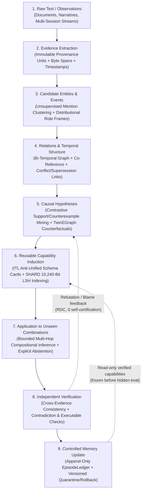

# 51 — Stage S11.1 Research Design Proposal: Raw-Observation Open-World Learning Experiment

- **Status:** `DESIGN_PROPOSAL_ONLY` (not yet implemented; preregistered against Stage S11.0 baseline protocol `s11.0-open-world-eval-v1`)
- **Implementation & Experimental Results:** Implemented in `research/open_world/learner/` (branch `research/open-world-s11-1-raw-observation-learning`); full 6-ablation hidden-split results and honest `1/4`-gate verdict (`S11_1_PARTIAL_PROGRESS__PREREGISTERED_GATES_NOT_ALL_PASSED`) documented in [`docs/52-open-world-generalization-s11-1-raw-observation-learning-results.md`](52-open-world-generalization-s11-1-raw-observation-learning-results.md).
- **Branch:** `research/open-world-generalization-s11`
- **Hard CPU-Native Constraints:** `0` GPU requirement · `0` pretrained LLM or external model weights · `0` external AI APIs · `0` backpropagation/neural training required · `0` manually supplied domain-specific action lists or event schemas · `0` mutations to production `.dcrystal` vaults

---

## 1. Scientific Motivation & Problem Statement

Stages **S0–S10** (`research/cpu_learning/`) proved that Mirror 7's unified **SHARD + ITL + RDC** loop can induce verifiable compositional operators from few examples on CPU when given clean `(before_state, action, after_state)` relational transitions and an interactive black-box simulator. Stage **S11.0** (`docs/50-open-world-generalization-s11-0-evaluation-foundation.md`) demonstrated why that narrow foundation does **not** yet transfer to open-world intelligence:

1. Real-world corpora (causal narratives, Wikipedia passages, multi-week user-assistant transcripts) arrive as **raw unstructured UTF-8 observations**, not pre-segmented state graphs.
2. Existing shipped Mirror organs (`existing_mirror_system`), staged legacy rules/blueprints (`existing_rule_blueprint`), pure BM25 lexical retrieval (`retrieval_only_bm25`), and shallow symbolic heuristics (`simple_symbolic_extractor`) fail to separate adversarial unanswerable questions from answerable ones, fail directional causal transfer across unseen clusters, and struggle with temporal ordering and knowledge updates across distractor-heavy multi-session transcripts.
3. PR #43 (`research-track-a-native-semantic-gate`) confirmed that neural latent transition models (MLP / linear operator) also failed their semantic-reasoning positive-margin gates (`0/3` seeds) and degraded sharply on deeper compositions (`len 5` margin `-0.1175`).

**Stage S11.1 Research Question:**
> Can a pure-CPU, zero-LLM, zero-neural-training learner discover reusable **evidence-grounded entity/event/relation/causal patterns and compositional capabilities** directly from raw, unstructured text observations — **without** manually supplied domain action lists or event schemas — and generalize them to source-disjoint unseen combinations while preserving source evidence, uncertainty, contradictions, and calibrated abstention?

---

## 2. End-to-End 9-Stage Architecture (Zero Manual Domain Schemas)

### Stage-by-Stage CPU-Native Specification

#### Stage 1 — Raw Text / Observations
- **Input contract:** Strictly public `OpenWorldObservation` / raw UTF-8 byte streams (documents, multi-turn timestamped sessions, raw narrative pairs).
- **Prohibition:** The learner receives **zero** manually supplied domain action lists (no hardcoded `move`/`give`/`open`/`lock`), **zero** domain predicate lists, **zero** hand-authored event schemas, and **zero** hidden gold annotations (`is_impossible`, `has_answer`, `answer_session_ids`, `mirrored`).

#### Stage 2 — Evidence Extraction
- **Mechanism:** Deterministic structural segmentation of raw UTF-8 streams into atomic `EvidenceUnit` records:
  - `(evidence_id, source_doc_or_session_id, byte_start, byte_end, observed_timestamp, speaker_role, raw_utf8_bytes, sha256)`
- **Mirror substrate reuse:** Append-only hash-chained SQLite `EpisodeLedger` (`research/cpu_learning/ledger/episode_ledger.py`) extended to store raw UTF-8 spans with immutable provenance links.
- **Invariant:** Every downstream entity, event, relation, causal hypothesis, or answer MUST trace back to one or more `evidence_id`s. Unanchored claims are structurally unrepresentable.

#### Stage 3 — Candidate Entities & Events (Schema-Free Induction)
- **Candidate Entities:** Induced strictly from observable text structure and cross-document/cross-session distributional statistics — no domain gazetteers:
  - Morphological & typographic span discovery (multi-token capitalized spans, quoted terms, numeric/quantity/date literals, repeated noun-chunk n-grams via linear-time `SequiturSymbolMinter` / boundary-entropy chunking).
  - Unsupervised entity-cluster resolution via **SHARD 10,240-bit BSC** context-window hypervectors + exact lexical/acronym/sub-span linking (`"Dr. Lina Patel"` ↔ `"Patel"`, `"my bicycle"` ↔ `"the bicycle"`), keeping ambiguous coreference links explicitly tagged with uncertainty scores rather than hard-merging.
- **Candidate Events:** Induced via **clause-boundary & predicate-argument frame discovery** (generalizing S7's raw-UTF-8 byte aligner and Plotkin anti-unification):
  - Segment clauses around punctuation, discourse boundaries, and high-frequency closed-class structural pivots learned purely by corpus frequency/entropy (NOT a hand-authored domain verb list!).
  - Represent each candidate event as an open-vocabulary `CandidateEvent(event_id, trigger_span, arg_spans, polarity, modality, time_ref, evidence_id, extraction_conf)` where `polarity ∈ {AFFIRMED, NEGATED, UNCERTAIN}` and `modality ∈ {FACTUAL, HYPOTHETICAL, PREFERENCE, QUERY}`.

#### Stage 4 — Relations & Temporal Structure (Bi-Temporal Contradiction Graph)
- **Intra- and Cross-Document Relations:** Build a typed-by-evidence hypergraph connecting candidate entities and events:
  - Explicit lexicalized surface relations `(arg_left, rel_surface_span, arg_right, polarity, evidence_id)` — preserving the raw relation surface phrase rather than mapping into a fixed closed ontology.
  - **Discourse & Temporal Ordering:** Parse explicit timestamps (session dates, ISO/calendar dates, durations) AND distributional order cues (document sequence order, session chronological order) into a **Bi-Temporal Interval Graph**:
    - *Event time* (`t_event`: when the event occurred, if stated; otherwise `UNKNOWN`)
    - *Observation time* (`t_obs`: when the observation/session was recorded)
- **Contradictory Observations & Belief Revision (Critical Open-World Requirement):**
  - When two grounded statements share an entity + attribute/predicate cluster (`(E, R, V1, t1)` and `(E, R, V2, t2)` with `V1 ≠ V2`):
    1. **NEVER delete or overwrite** `(E, R, V1, t1)`! Both stay permanently linked to their original `evidence_id`s.
    2. If `t2 > t1` AND discourse evidence indicates state change/revision (or same speaker updates own state in later session, as in LongMemEval `knowledge-update`), emit an explicit `SUPERSEDES(e2 -> e1)` edge while preserving `e1` for historical ("previously / before") queries!
    3. If `t1 == t2`, timestamps are absent, or independent sources disagree without supersession evidence, mark the claim `CONTESTED` (preserving both values, raising epistemic uncertainty, and triggering honest abstention if no disambiguating evidence exists!).
  - **Mirror substrate reuse:** `QuotientEGraph` + Poole-specificity `TropicalJTMS` + `MengerProvenanceVerifier` (`mirror_crystal/quotient_egraph_resonator.py`, `hippocampal_sdm_memory.py`) for tracking independent vs redundant corroboration paths.

#### Stage 5 — Causal Hypotheses
- **Schema-Free Causal Discovery from Raw Observations:**
  - Mine directed event-frame transitions `(EventFrame_A -> EventFrame_B)` from:
    1. Explicit discourse-connected event pairs observed in raw training corpora (distributional mutual information / directional PMI over generalized *frame clusters*, not just raw unigram bags!).
    2. Chronological cross-session/cross-sentence event successions `(E1 at t1, E2 at t2)` filtered by **contrastive counterfactual lift**:
       $$\text{CausalLift}(F_A \to F_B) = \log \frac{P(F_B \mid F_A) + \alpha}{P(F_B \mid \neg F_A) + \alpha} - \log \frac{P(F_A \mid F_B) + \alpha}{P(F_A \mid \neg F_B) + \alpha}$$
       Asymmetry separates directional causality (`cause -> effect`) from symmetric topical co-occurrence (addressing Balanced COPA's mirrored counterfactual pairs directly!).
  - Every candidate causal link is stored as a **tentative `CausalHypothesis`** carrying:
    - `support_evidence_ids` (distinct source clusters supporting `A -> B`),
    - `counterexample_evidence_ids` (source clusters where `A` occurred and `¬B` or contradictory `B'` occurred),
    - `epistemic_status = "HYPOTHESIS_UNVERIFIED"` (never asserted as certain fact!),
    - `uncertainty_interval = (ci_low, ci_high)` via Wilson / Beta-Binomial credible bounds from distinct source clusters.
  - **Mirror substrate reuse:** `TwinEGraphDoCalculus` for evaluating counterfactual consistency when applying a causal hypothesis without corrupting base observed facts.

#### Stage 6 — Reusable Capability Induction
- **Generalizing ITL + SHARD to Open-World Extraction & Reasoning Skills:**
  - Rather than hand-coding task solvers, apply **structural anti-unification** (generalizing S2's `RoleUnifier` and `OperatorInducer`) across repeatedly verified multi-step inference traces in the `train` split to induce reusable `OpenWorldCapabilityCard`s:
    - **Query-to-Evidence Alignment Patterns** (e.g., mapping question constraint structure + entity/polarity/time requirements to graph traversal queries).
    - **Temporal Revision & Ordering Procedures** (e.g., traversing `SUPERSEDES` chains for current-state queries vs `t_obs` ordering for earlier/later queries).
    - **Causal Frame Bridging Schemas** (abstracting entity-specific causal pairs into reusable distributional frame-cluster transitions indexed by **SHARD 10,240-bit BSC + LSH** for sub-millisecond CPU candidate proposal).
  - **MDL Compression Discipline (RDC):** A capability card is retained ONLY if it compresses multiple distinct source-cluster training traces (`support >= k_min` distinct source clusters, default `k_min = 3`) AND improves validation predictive/verification objective without increasing unsupported-answer rate.

#### Stage 7 — Application to Unseen Combinations
- At inference time (strictly after `.freeze()`, `0` memory writes allowed!):
  1. Extract `EvidenceUnit`s, candidate entities/events, and the local bi-temporal graph strictly from the unseen `OpenWorldObservation` (unseen Wikipedia article, unseen mirrored COPA pair, unseen multi-session haystack).
  2. Use **SHARD 10,240-bit LSH** to propose top-$K$ candidate `OpenWorldCapabilityCard`s and `CausalHypothesis` frames matching the unseen query + local evidence graph.
  3. Compose up to bounded depth $D \le 3$ (e.g., Entity Linking → Temporal Supersession Resolution → Multi-Session Evidence Aggregation → Polarity/Negation Compatibility Check).
  4. Compute explicit **Epistemic Support Vector**:
     - `entity_grounding_coverage` (fraction of query entities/constraints grounded in local evidence)
     - `relation_and_polarity_consistency` (zero unresolved negation or entity-swap contradiction)
     - `hypothesis_support_margin` (gap between best and runner-up candidates weighted by credible intervals)
  5. **Mandatory Calibrated Abstention Gate:** If entity/constraint grounding fails, if a critical entity/relation in the question has **zero** evidence support (SQuAD v2 unanswerables / LongMemEval `*_abs`), if conflicting evidence is `CONTESTED` without supersession, or if calibrated confidence falls below the validation-tuned threshold, the learner **MUST ABSTAIN** and emit an inspectable `abstain_reason` + supporting uncertainty trace.

#### Stage 8 — Independent Verification (Zero Self-Certification)
- **Core Mirror Rule:** Similarity (SHARD) and compression (MDL) are **NEVER proof**.
- Candidate answers and candidate induced capabilities must pass **independent verification checks** distinct from the proposer:
  1. **Evidence Entailment & Span-Grounding Verifier:** Independently verifies that every entity, number, date, and polarity constraint in the proposed answer is directly entailed by the cited `evidence_id` byte spans (rejecting hallucinated spans or mismatched dates/numbers).
  2. **Contradiction & Supersession Audit Verifier:** Independently scans the entire local bi-temporal graph for any later superseding observation (`t_later > t_cited`) or concurrent contradicting claim; if an unaddressed supersession or conflict exists, rejects or downgrades the candidate!
  3. **Source-Disjoint Cross-Cluster Verification (for Capability Promotion):** An induced `OpenWorldCapabilityCard` or `CausalHypothesis` can ONLY move from `shadow` → `verified` after independent verification passes across at least `k_min >= 3` **source-disjoint** training/validation clusters AND fails zero regression checks on the held-out replay suite.
  4. **Executable Verification (when applicable):** Any induced numeric/date-difference or compositional computation is verified in `ZeroTrustSandboxJudge` / exact arithmetic evaluators.

#### Stage 9 — Controlled Memory Update
- **Strict Governance (reusing S3 `OperatorVersionStore` & S8 `ContinualKnowledgeBase`):**
  - Append-only `EpisodeLedger` stores raw evidence hashes; learned capabilities live in a separate versioned store (`shadow` → `verified` → `retired` / `quarantined`).
  - **Zero Silent Overwrites:** New observations never erase prior evidence; superseding facts add timestamped edges.
  - **Mandatory Regression Replay & Automatic Rollback:** Before any capability version update is committed, replay a frozen source-disjoint regression suite; any drop in accuracy, evidence F1, or unanswerable abstention recall triggers automatic quarantine and non-destructive rollback.
  - **Strict Evaluation Freeze:** `.freeze()` permanently blocks all memory writes, ledger appends, and capability updates before evaluating on `hidden_eval` (`post_freeze_writes == 0` verified programmatically).

---

## 3. Experimental Protocol, Ablations & Falsification Criteria

### 3.1 Controlled Ablation Matrix (Required for S11.1 Acceptance)
Every component in the 9-stage loop must prove measurable value on the **exact S11.0 source-disjoint splits** (`balanced_copa`, `squad_v2`, `longmemeval`):

| Ablation ID | Component Disabled | Hypothesis Being Falsified |
|---|---|---|
| `A1_no_evidence_grounding_verifier` | Disable Stage 8 span/entity/polarity verifier | Tests whether independent verification actually cuts hallucination on unanswerables & unsupported answers. |
| `A2_no_bitemporal_supersession` | Flatten timestamps & drop `SUPERSEDES` edges | Tests whether bi-temporal revision specifically drives gains on LongMemEval `knowledge-update` & `temporal-reasoning`. |
| `A3_no_asymmetric_causal_lift` | Replace asymmetric causal lift with symmetric co-occurrence | Tests whether directional causal modeling genuinely improves Balanced COPA mirrored-pair consistency & cross-relation transfer. |
| `A4_no_capability_anti_unification` | Keep raw instance lookup instead of Stage 6 induced cards | Tests whether generalized capability induction beats instance memorization on unseen Wikipedia articles & unseen sessions. |
| `A5_no_shard_lsh_indexing` | Exhaustive linear scan over candidate frames/cards | Tests whether SHARD 10,240-bit BSC + LSH reduces CPU latency at equal accuracy. |
| `A6_no_abstention_gate` | Force answering on all items | Measures true selective accuracy vs unanswerable hallucination cost. |

### 3.2 Preregistered S11.1 Quantitative Promotion Gates (Fixed in `s11_0_preregistration.json`)
Any S11.1 candidate architecture MUST satisfy ALL four preregistered gates simultaneously on the frozen S11.0 source-disjoint hidden evaluation splits before any claim of open-world improvement is permitted:

1. **`S11_1_G1` (Causal Commonsense — Balanced COPA):** Beat the best non-oracle S11.0 baseline on `hidden_eval` primary accuracy by **`>= +5.0pp`** (non-overlapping bootstrap 95% CI) AND achieve validation mirrored-pair consistency **`>= 50.0%`** without manual schemas.
2. **`S11_1_G2` (Evidence-Grounded QA & Abstention — SQuAD 2.0):** Beat the best non-oracle S11.0 baseline on unseen Wikipedia articles on **BOTH** answerable Token-F1 (`>= best_baseline + 5.0pp`) **AND** overall Token-F1 (`>= best_baseline + 5.0pp`), achieve `evidence_f1 >= best_baseline`, `unanswerable_abstention_recall >= 0.70`, `answerable_false_abstention_rate <= 0.30`, and `ECE <= 0.15` (preventing trivial always-abstain gaming).
3. **`S11_1_G3` (Long-Term Multi-Session Memory — LongMemEval):** Beat the best non-oracle S11.0 baseline on session-disjoint `hidden_eval` primary score by **`>= +5.0pp`**, improve cross-category transfer (`session -> temporal/update`), achieve `evidence_f1 >= best_baseline`, and abstain on **`>= 60.0%`** of genuine `*_abs` unanswerable episodes.
4. **`S11_1_G4` (CPU-Native Governance & Isolation):** `0` GPU, `0` pretrained LLMs, `0` external AI APIs, `0` required neural training, `0` manual domain action/event schemas, `0` AST isolation violations, `0` post-freeze memory writes, `< 256 MB` peak `tracemalloc` heap, and `0` modifications to production `.dcrystal` vaults.

### 3.3 Explicit Stop / Falsification Conditions
- If S11.1 fails to beat `simple_symbolic_extractor` and `retrieval_only_bm25` on source-disjoint hidden splits, **do not weaken gates or inject dataset-specific rules**; localize failure by stratum (just as PR #43 localized chain-length failure) and report the negative result transparently.
- Never promote shadow hypotheses/capabilities without independent multi-cluster verification.
- Never claim general open-world human/GPT parity from passing S11.1 on three benchmarks; any passing S11.1 result establishes **first verified CPU-native raw-observation learning on bounded real-world language & memory splits**, opening S11.2 (broader multi-hop datasets such as HotpotQA / WinoGrande / full 277 MB `longmemeval_s_cleaned.json`).
